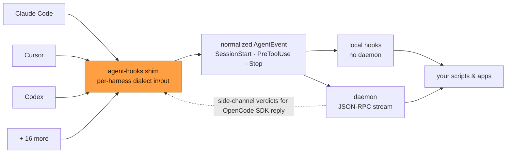
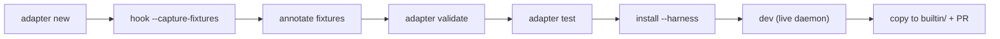

# agent-hooks

**Universal lifecycle hooks and observability engine for AI coding agent harnesses.**

One binary, three jobs:

1. **Hook shim (`agent-hooks hook`)** — drops into any harness's hook config, runs in `<2ms`, never blocks the agent.
2. **Installer (`agent-hooks install`)** — registers the shim in every harness config on your machine, preserving comments and user settings.
3. **Daemon (`agent-hooks daemon`)** — normalizes every harness event into one lifecycle stream your app/cli/process can subscribe to



You do **not** need the daemon to get value. The fast path is daemonless local hooks (`~/.agent-hooks/hooks.json`) — same file works across all 19 harnesses. Add the daemon when you want live policy, cross-harness session tracking, or app subscriptions.

---

## Contents

- [Supported harnesses](#supported-harnesses)
- [Install the binary](#install-the-binary)
- [Quickstart: automate your agent in 2 minutes (no daemon)](#quickstart-automate-your-agent-in-2-minutes-no-daemon)
- [Quickstart: live events for apps (daemon)](#quickstart-live-events-for-apps-daemon)
- [Command reference](#command-reference)
- [Conversation history (opt-in)](#conversation-history-opt-in)
- [Local hooks reference](#local-hooks-reference)
- [Daemon + socket protocol](#daemon--socket-protocol)
- [Using with Python / TypeScript / Rust / shell](#using-with-python)
- [Add a harness: write an adapter](#add-a-harness-write-an-adapter)
- [Adapter manifest reference](#adapter-manifest-reference)
- [Edge cases and failure modes](#edge-cases-and-failure-modes)
- [Troubleshooting](#troubleshooting)
- [Workspace layout](#workspace-layout)
- [License](#license)

---

## Supported Harnesses

Source of truth: `crates/agent-hooks-adapters/builtin/*/adapter.json`. `agent-hooks list-adapters` prints this same table from the binary (IDs, aliases, hook file locations).

<!-- adapters:start -->
| Harness | Adapter ID | Hook config written by installer | Install mechanism | Status |
| :-- | :-- | :-- | :-- | :-- |
| Amp | `amp` (`ampcode`, `sourcegraph-amp`, `sourcegraph_amp`) | `~/.config/amp/plugins` | `stage_assets` | Verified |
| Claude Code | `claude-code` (`claude`, `anthropic`, `claude_code`) | `~/.claude/settings.json`, `.claude/settings.json` | `json_hooks, matcher_group` | Verified (2.1.296) |
| Codex | `codex` (`openai-codex`, `codex-cli`) | `~/.codex/hooks.json`, `.codex/hooks.json` | `json_hooks, matcher_group` | Verified |
| Cursor | `cursor` (`cursor-agent`, `cursor-cli`) | `~/.cursor/hooks.json`, `.cursor/hooks.json` | `json_hooks, flat` | Verified |
| Factory Droid | `droid` (`factory-droid`, `factory_droid`, `factory`) | `~/.factory/hooks.json`, `.factory/hooks.json` | `json_hooks, matcher_group` | Docs-only |
| Gemini CLI | `gemini-cli` (`gemini`, `google-gemini`, `gemini_cli`) | `~/.gemini/settings.json` | `json_hooks, matcher_group` | Verified |
| GitHub Copilot | `copilot` (`github-copilot`, `github_copilot`, `copilot-cli`, `copilot_cli`) | `~/.copilot/settings.json`, `.github/hooks/hooks.json` | `json_hooks, flat` | Verified |
| Google Antigravity | `antigravity` (`google-antigravity`, `antigravity-cli`) | `~/.gemini/config/hooks.json`, `.agents/hooks.json` | `json_hooks, named` | Verified (1.4.2) |
| Hermes | `hermes` (`hermes-agent`, `hermes_agent`) | `~/.hermes/plugins/agent-hooks` | `stage_assets` | Verified |
| JCode | `jcode` (`jcode-cli`, `jcode_cli`) | `~/.jcode/config.toml` | `toml_hooks, command` | Verified |
| Kimi Code | `kimi-code` (`kimi`, `kimi_code`, `kimi-cli`, `kimi_cli`) | `~/.kimi-code/config.toml` | `toml_list_hooks` | Docs-only |
| Kiro | `kiro` (`kiro-cli`, `kiro_cli`) | `~/.kiro/agents/agent-hooks.json`, `~/.kiro/settings/cli.json` | `json_hooks, flat`; `json_edit` | Verified |
| Mistral Vibe | `mistral-vibe` (`mistral`, `vibe`, `mistral-vibe-cli`, `vibe-code`) | `~/.vibe/hooks.toml`, `.vibe/hooks.toml` | `toml_list_hooks` | Docs-only |
| Muse | `muse` (`muse-code`, `muse-cli`) | `~/.config/muse/settings.json`, `.muse/hooks.json` | `json_hooks, matcher_group` | Verified (1.4.7) |
| Oh My Pi | `omp` (`oh-my-pi`, `oh_my_pi`) | `$XDG_DATA_HOME/agent-hooks/plugins/oh-my-pi` | `stage_assets`; `run_command` | Verified (18.12.3) |
| OpenCode | `opencode` (`opencode-ai`) | `~/.config/opencode/plugins` | `stage_assets` | Verified |
| Pi | `pi` (`pi-agent`, `pi_agent`) | `~/.pi/agent/extensions` | `stage_assets` | Verified |
| Qoder | `qoder` (`qoder-cli`, `qoder_cli`) | `~/.qoder/settings.json`, `.qoder/settings.json`, `.qoder/settings.local.json` | `json_hooks, matcher_group` | Docs-only |
| Qwen Code | `qwen-code` (`qwen`, `qwen_code`, `qwen-cli`, `qwen_cli`) | `~/.qwen/settings.json`, `.qwen/settings.json` | `json_hooks, matcher_group` | Docs-only |

`Verified` = exercised against the live CLI; the version in parentheses is the harness release last checked (`verified_against` in `adapter.json`). `Docs-only` = built from the published hook contract, never run live (`unverified: true`). Generated by `scripts/gen-adapter-table.py`; do not edit by hand.
<!-- adapters:end -->

### Amp

Install the plugin bridge with:

```bash
agent-hooks install --harness amp
```

Restart Amp to load `~/.config/amp/plugins/agent-hooks.ts`. Amp support gates
tool calls and handles structured questions through the supported
`agent_hooks_ask` plugin tool. It cannot intercept arbitrary questions shown by
Amp's native UI; those remain under Amp's own UI and permission handling.

Ordinary Amp tool calls remain `PreToolUse` events, so existing local command
policies continue to apply. The `agent_hooks_ask` tool emits `PermissionRequest`
with normalized questions.

To answer Amp requests from another terminal (including a Herdr tab), run:

```bash
agent-hooks daemon --socket /tmp/agent-hooks-amp.sock
# In another terminal:
agent-hooks install --harness amp --socket /tmp/agent-hooks-amp.sock
agent-hooks answer --socket /tmp/agent-hooks-amp.sock
```

Restart Amp after installing, then ask it to use `agent_hooks_ask`. Questions
carry stable IDs, option labels, `multiple` and `custom` flags; answers preserve
selected labels and custom text separately. Structured-answer hosts distinguish
questions by ID even when their question text is identical. An empty
`custom_input` is treated as absent; nonempty text is preserved without trimming.
Without an external answer, the
plugin falls back to Amp's input/select dialogs. Cancellation does not approve
or fabricate an answer. Permission decisions support allow, deny, or ask
(Amp's native confirmation dialog); approvals do not override Amp's own policy.
The legacy line-mode answer client responds only to daemon-stamped held events,
not observe-only lifecycle notifications. `--auto` and `--line` are manual
test interfaces; structured apps should use `--return --decision` for an
offline hook answer, or target a pending daemon prompt by session/prompt ID.
Session IDs do not provide an offline rendezvous.

`install --harness all` touches every harness above. Plugin harnesses (OpenCode, Pi, Oh My Pi) have no hook-config file — the installer stages a bridge file. Oh My Pi additionally runs the harness's own registration command (`omp plugin install`); OpenCode and Pi need none (their extension/plugin dirs are auto-loaded).

### Muse Code

```bash
agent-hooks install --harness muse
```

The installer registers user and project hooks, adds the required
`schema_version: 1` only when missing from user settings, and preserves
existing settings and foreign hooks on reinstall and uninstall. Restart
Muse to reload hooks; project hooks require a trusted workspace.

The adapter recognizes 20 native events in Muse Code 1.4.6, including
`PreLLMCall`, `PostLLMCall`, `PostToolBatch`, `StopFailure`, `SessionFork`,
and `ToolUseStart`. Model calls, batches, and tool-execution starts have
distinct normalized lifecycle markers; full native details remain in
`raw_event`. `SessionFork` initializes a `SessionStart` with the fork's ID.
`Interrupt` and `ToolUseStart` install as asynchronous observation hooks.
Gate handlers allow 600 seconds for a decider; observation handlers use
5 seconds.

Muse tool approvals require `updatedInput`, so an approval echoes the original
tool arguments unchanged. Permission requests use the separate
`decision.behavior` dialect; a blocked `Stop` requests continuation.
The adapter advertises allow/deny, not native question answering.

Verified with the actual Muse echo provider: session/prompt/model-call/stop/end
events and prompt denial. Tool/permission replies are covered by adapter tests
and a real shim/daemon round trip, but were not exercised by a live Muse tool
call. `PostToolBatch` and `StopFailure` are mapped; the installed 1.4.6 binary
identifies them as staged events, so their live emission is not verified.

For the broader agent coverage comparison and recommended next integrations,
see [the Vibe Island support audit](docs/vibe-island-support-audit.md).

---

## Install the binary

Prebuilt binaries on [GitHub Releases](https://github.com/builtby-win/agent-hooks/releases) (tag `v*`: macOS arm64/x64, Linux x64, Windows x64). Verify checksums with the sibling `.sha256` files.

```bash
# macOS arm64 (M1+) — pick the asset matching your platform:
#   agent-hooks-aarch64-apple-darwin.tar.gz        macOS arm64
#   agent-hooks-x86_64-apple-darwin.tar.gz         macOS Intel
#   agent-hooks-x86_64-unknown-linux-gnu.tar.gz    Linux x64
#   agent-hooks-x86_64-pc-windows-msvc.zip         Windows x64
tar -xzf agent-hooks-aarch64-apple-darwin.tar.gz
sudo mv agent-hooks-aarch64-apple-darwin/agent-hooks /usr/local/bin/
```

Windows (PowerShell):

```powershell
Expand-Archive agent-hooks-x86_64-pc-windows-msvc.zip
Move-Item agent-hooks-x86_64-pc-windows-msvc\agent-hooks.exe "$env:LOCALAPPDATA\Programs\agent-hooks\"
```

Install the CLI directly from the public Git repository with Cargo:

```bash
cargo install --git https://github.com/builtby-win/agent-hooks agent-hooks-cli
```

Or build the checkout you're working in:

```bash
cargo install --path crates/agent-hooks-cli
```

A crates.io install (`cargo install agent-hooks-cli`) will be available after the workspace crates are published, with internal dependencies published before the CLI.

---

## Quickstart: automate your agent in 2 minutes (no daemon)

This is the recommended first run. No background process, no socket, works on every harness.

```bash
agent-hooks init                  # scaffold ~/.agent-hooks/hooks.json
agent-hooks install --harness all # register the shim in every harness config
```

`init` writes a starter file mapping **normalized** lifecycle events to shell commands:

```json
{
  "version": 1,
  "hooks": {
    "PreToolUse": [{ "command": "~/.agent-hooks/block-rm.sh", "timeout": 10 }],
    "PostToolUse": [{ "command": "~/.agent-hooks/log-tool.sh" }]
  }
}
```

Every hook invocation pipes the normalized `AgentEvent` JSON (session id, tool name/args, context) to your script's stdin, with `AGENT_HOOKS_EVENT` / `AGENT_HOOKS_SESSION` / `AGENT_HOOKS_HARNESS` in the environment. Script protocol: exit `0` = allow, `2` = deny (stderr = reason), `3` = ask (stderr = question); anything else, a timeout, or a missing binary = fail-open allow with a stderr warning. Merge precedence is deny > ask > allow. Full contract in [Local hooks reference](#local-hooks-reference).

Per-project hooks: `agent-hooks init --project` scaffolds `./.agent-hooks/hooks.json`. Project hooks add to `~/.agent-hooks/hooks.json` rather than replacing it: both run for an event. The shim finds the project from the session's working directory (the one the harness reports, else its own) and includes every `.agent-hooks/` up to the git root, so monorepo roots and nested packages all apply.

Then do real work in your agent. To confirm the shim is firing without involving any harness:

```bash
echo '{"session_id":"abc","tool_name":"Edit","tool_input":{}}' \
  | agent-hooks hook claude-code --event PreToolUse
```

---

## Quickstart: live events for apps (daemon)

Add the daemon when you want cross-harness session tracking, live policy decisions, or app subscriptions (status bars, multiplexers, dashboards — e.g. Back2Vibing, Herdr).

```bash
agent-hooks install --harness all
agent-hooks daemon &
agent-hooks status
```

The daemon listens on `/tmp/agent-hooks.sock` (macOS/Linux) or `\\.\pipe\agent-hooks` (Windows); override with `--socket` or `AGENT_HOOKS_SOCKET`. `status` shows daemon health, active sessions, and per-harness install state (it derives the harness list and config paths from the manifests, so it stays correct as adapters are added). `status --json` emits machine-readable output.

From a checkout, `cargo dev` is the loop: starts a local daemon, waits for a real socket ping, installs detected harness hooks with the dev binary and socket, then prints live normalized events. Ctrl-C stops the daemon.

```bash
cargo dev
cargo dev --harness pi   # target one harness
cargo dev --no-install   # don't touch harness config
```

`--socket /tmp/my-agent-hooks.sock` isolates parallel dev daemons; the selected socket is embedded in installed hook commands.

> **Reboots:** `/tmp/agent-hooks.sock` does not survive a reboot and the daemon is not auto-started — there is no launchd/systemd unit yet. After a reboot, restart `agent-hooks daemon` (hooks stay installed; only the daemon needs relaunching). Daemon-down is always safe: the shim falls back to the local-hooks decision (allow when nothing matches) and exits 0.

---

## Command reference

```
agent-hooks hook <harness> --event <Name> [--harness <override>]
              [--socket PATH] [--adapter-version v1] [--capture-fixtures DIR]
              [payload...]
agent-hooks answer [<session_id>] [--prompt-id ID] [--socket PATH]
              --decision JSON
agent-hooks answer --return --decision JSON
agent-hooks answer [--socket PATH] [--auto [FILTER] | --line]
agent-hooks daemon [--socket PATH] [--log-level info] [--history [--history-dir DIR]]
agent-hooks dev [--harness all] [--socket PATH] [--no-install] [--log-level info]
agent-hooks install --harness <id|all> [--binary-path PATH] [--socket PATH]
              [--adapter-version VERSION]
agent-hooks uninstall --harness <id|all>
agent-hooks status [--socket PATH] [--json]
agent-hooks list-adapters [--json]
agent-hooks init [--project]
agent-hooks plugin list | install <path> | uninstall <id> | enable <id> | disable <id> | validate <path>
agent-hooks adapter new <id> | validate <target> | test <target> | add <source> | list
```

Notes that bite:


- `hook` reads the payload from **stdin first**, trailing argv second. If the first positional arg looks like JSON (`{...`), it is treated as the payload and the harness is sniffed via registry detection (Codex quirk) unless `--harness` overrides. `--event` is the **host** event name (`PreToolUse`, `stop`, `beforeSubmitPrompt` — case varies per harness, see the adapter's `events` map).
- `install`/`uninstall` accept a canonical ID, any alias, or a lenient substring (`--harness codex` matches `openai-codex`), plus `all`. Unknown names error with the known-ID list. Reinstalls are idempotent (`dedupe: command_subset` — an entry with the same command is not duplicated). Uninstall removes only agent-hooks entries/assets it recognizes; user hooks are untouched.
- `--binary-path` / `--socket` bake non-default locations into installed hook commands (dev daemons, custom sockets). Otherwise the installer embeds the running binary's path and the default socket.
- `--adapter-version` pins a manifest version (all builtins ship `v1` today). Omit it to use `default_version`.
- `adapter add` installs an external manifest (file path, git URL, or https tarball) into the user tier with a `.meta.json` provenance sidecar. `adapter list` shows builtin + user + project tiers and their source paths.

## Answering prompts from apps

Apps and shell hooks can use `agent-hooks answer` without implementing socket/RPC
code. Use simple flags, or keep the canonical JSON interface for advanced decisions.
Offline commands receive the normalized `AgentEvent` JSON on stdin:

```bash
agent-hooks answer --return --allow
agent-hooks answer --return --deny "Protected branch"
agent-hooks answer --return --select "color" "Blue"
agent-hooks answer --return --custom-input "notes" "Use the existing database"

# Full canonical decision JSON is still supported:
agent-hooks answer --return --decision '{"allow":true,"answers":[{"question_id":"color","selected_options":["Blue"]}]}'
```

`--select QUESTION_ID OPTION_LABEL` selects an exact option label; repeat it for multiple
questions or multi-select choices. `--custom-input QUESTION_ID TEXT` supplies custom text,
once per question. Answer flags imply allow, and `--allow` may also be explicit.
Options and custom text can be combined only for multi-select questions. These
flags build the same canonical decision and use the same validation as JSON.
Conflicting verdicts or mixing simple flags with `--decision` are errors.

The command reads the event from stdin, validates the decision against its
questions, and writes only canonical decision JSON to stdout on success
(exit `0`). Validation/input errors produce an actionable stderr diagnostic,
no stdout, and exit `2` so the local hook denies rather than treating the
error as a fail-open infrastructure failure. It does not connect to or start
a daemon. Session IDs alone cannot rendezvous with an offline hook invocation:
there is no asynchronous offline queue.

To answer an already-pending daemon prompt by session, the CLI selects exactly
one pending prompt for that session and validates the decision against that
prompt's questions before responding:

```bash
agent-hooks answer SESSION_ID --select "color" "Blue"
agent-hooks answer --prompt-id PROMPT_ID --deny "Protected branch"
agent-hooks answer SESSION_ID --decision '{"allow":true,"answers":[{"question_id":"color","selected_options":["Blue"]}]}'
```

`--prompt-id` targets that exact pending prompt; it can be combined with a
session ID only as an additional match constraint. No match, ambiguous
session match, invalid/noncanonical decision, or RPC failure is an error
reported on stderr with a nonzero exit status. This one-shot command answers
an already-held prompt; it does not establish a persistent decider
subscription or make future gates wait. An app/decider must be subscribed with
`decide: true` when events occur. Both simple flags and `--decision` require either
`--return` or a target (`SESSION_ID` / `--prompt-id`); they cannot be combined with
`--auto` or `--line`. Existing no-argument TUI, `--auto`, and `--line` behavior is
unchanged.

For single-select questions in the TUI, entering custom text replaces the
selected option, and selecting an option clears custom text. Multi-select
questions can combine options and custom text. A custom-only question cannot
be submitted with empty text; `custom: false` disables its editor. Submitted
free text is preserved exactly, without trimming.

---


## Conversation history (opt-in)

```
agent-hooks history init [--history-dir DIR]
agent-hooks daemon --history [--history-dir DIR]   # also record events forwarded from remote machines
agent-hooks history sessions [--session ID] [--search TEXT] [--harness H] [--origin O] [--after CURSOR] [--limit N]
agent-hooks history messages --session ID [--harness H] [--origin O] [--after CURSOR] [--before SEQ] [--limit N] [--kind user,assistant]
agent-hooks history status
```

Default directory: `$AGENT_HOOKS_HISTORY_DIR`, else `~/.agent-hooks/history` (`history.sqlite3`, mode 0700/0600 on Unix).

- **Off by default.** Only `history init` creates the store; a plain `hook` or `daemon` never does. Capture is done by the `hook` shim itself: once the store exists, every hook writes its own entry. No daemon is involved, so history is complete even when the daemon is down or was never started. The shim finds the store at the default location or `$AGENT_HOOKS_HISTORY_DIR` (set it in the agent's environment; `--history-dir` applies only to `history` subcommands).
- **Remote machines.** A remote shim writes to the *remote* machine's own store (if it has one). To land a remote machine's history on this one, install the remote hooks with `--origin <label>`, forward the daemon socket to the remote (e.g. `ssh -R`), and run `agent-hooks daemon --history` here. The daemon records only events that carry an origin label, because local hooks were already recorded by their own shim; it fails at startup if the store is missing, and nothing is recorded while the daemon is down. Query with `--origin <label>`.
- **What is stored:** each complete `UserPromptSubmit` prompt, normalized `TurnEnd.assistant_message` or `Stop.summary` text as an `assistant` entry (`assistant_content_source: "assistant_text"`), and tool entries: name, call id, status (running/completed/failed), the compact-JSON tool input, and the tool output or error string the adapter normalized from the post-tool hook (a harness may supply only a preview; the store never invents more). OMP and Pi capture identified assistant replies at turn end, even while background jobs keep the run busy; a later Stop with the same native message identity updates that entry rather than duplicating it. Antigravity's adapter reads the latest completed `MODEL`/`PLANNER_RESPONSE` from the current turn in `transcriptPath` before falling back to its termination reason; it never reuses a previous turn's reply. Transcript lookup scans at most the last 1 MiB and falls back when no complete reply is found. Other harnesses may supply only a summary, not the full native reply. Env, raw payloads and the rest of the event are never stored. Captured nonblank text is never truncated or capped, however large.
- **OpenCode V2.** The prompt hook records submitted user text. After a successful execution, the plugin reads the session context and stores the latest assistant text as the `Stop.summary`; reasoning and tool blocks are not treated as assistant prose.
- **Tool phases stay separate.** A tool entry (`kind: "tool"`) reports `tool_input` (the running/pre-call observation) and `tool_output` (the terminal completed/failed observation) as independent exact strings; either is absent until observed and they are never concatenated. Repeated hooks for the same native tool call update one entry rather than adding rows, and an exact redelivery of one hook is a no-op. Entries recorded by schema v1 kept a single combined tool `text` whose input/output boundary was not recorded; the upgrade preserves that string verbatim in `text` on those old tool entries and does not guess a split. Only pre-upgrade tool entries have tool `text`; user/assistant entries use `text`.
- **Secrets, compression, no retention limit.** Prompts, summaries and tool inputs/outputs can contain secrets. Access is restricted to the owning user (directory 0700, files 0600), but the data is **not encrypted**: values over 1 KiB are transparently compressed with lossless zstd, only when smaller, purely to save space, and compression is not encryption. Query output is byte-identical to what was captured. There is no retention limit. Remove the history by deleting the directory.
- **Schema upgrades.** `history init` (or the next recording hook) upgrades a v1 store to v2 in one atomic transaction, preserving every entry, session, receipt, cursor position and byte of text; until then read-only queries report `schema_upgrade_required`. A migrated store may keep reusable free pages: the compact metadata and compression reduce the space the data occupies, but the file's historical high-water mark does not shrink on its own, and nothing runs `VACUUM` automatically. Run an explicit SQLite `VACUUM` (with the agents and daemon stopped) to return that space to the filesystem. A store that cannot be decoded (corrupt or truncated compressed data) makes queries fail with `store_unavailable` rather than return garbled text.
- **Prospective only.** There is no transcript import; sessions are keyed by `(origin, harness, native session id)` and events without a harness-native session id are skipped. Use `--harness`/`--origin` when the same id exists more than once (`ambiguous_session`).
- **Session titles.** Harness-pushed `AgentEvent.session_title` is stored as `HistorySession.title`, including later renames. Missing or blank titles do not erase a known title; older observations cannot overwrite a newer title. Pi/OMP push `getSessionName()`, OpenCode forwards session title updates, Amp forwards `thread.title`, and other harnesses can supply `session_title` or `sessionTitle`. No title is invented when a harness provides none.
- **Find sessions.** `history sessions --search "login"` matches a literal substring of the current title, native session id, or workspace. Matching ignores ASCII case; non-ASCII letters match exactly. `%` and `_` are literal, not wildcards. Surrounding whitespace is ignored and blank search means no filter. Search combines with the exact `--session`, `--harness`, and `--origin` filters and is applied before pagination. Reuse the same search text with `--after`; changing it requires starting a new listing. Titles remain live between pages, so a concurrent rename can change whether an existing session matches.
- **Failure-safe.** A write waits at most 200 ms on the SQLite writer lock (parallel agents share one store), never changes a verdict or exit code, and a failure prints a stderr warning without content. Two separate prompts with identical text are two entries.
- **Queries are read-only**, need no daemon, and print versioned JSON (`api_version: 2`; v2 adds `tool_input`/`tool_output` on tool entries and no longer concatenates tool phases into `text`) — the JSON, not the SQLite schema, is the contract. There is deliberately no history RPC on the (world-writable) hook socket. `history messages --kind` (repeatable or comma-separated; default all) filters entry kinds in SQL before payloads decode and pages are cut, so a chat view passes `--kind user,assistant` to skip large tool bodies; a cursor only works with the kind set it was issued for.
- **Scroll-up paging.** `history messages --before SEQ` returns the newest page below that entry sequence, oldest first, in one indexed query with no `next_cursor`; pass the first returned item's `seq` as the next `--before` to keep loading older rows. It cannot combine with `--after`, and a page shorter than `--limit` means the start of the history. Forward `--after` paging is unchanged.

Rust consumers use the same query contract directly, without knowing the SQLite schema:

```rust
use agent_hooks_history::{resolve_history_dir, HistoryReader, SessionsQuery};

let reader = HistoryReader::open(&resolve_history_dir(None))?;
let mut query = SessionsQuery {
    search: Some("login".into()),
    limit: Some(50),
    ..Default::default()
};
loop {
    let page = reader.sessions(&query)?;
    for session in page.items {
        println!(
            "{}: {}",
            session.key.session_id,
            session.title.as_deref().unwrap_or("Untitled")
        );
    }
    query.after = page.next_cursor;
    if query.after.is_none() {
        break;
    }
}
```

---

## Local hooks reference

Files: `~/.agent-hooks/hooks.json` (user tier) and `.agent-hooks/hooks.json` in the session's project (project tier). Tiers **accumulate**, as in Claude Code's user/project/local settings: for each event the entries run user first, then each project layer from the git root down to the session's directory, all in parallel, with deny > ask > allow. A handler defined identically at two levels runs once. A project layer is any `.agent-hooks/` directory from the session's working directory up to the git root — so a monorepo root and a nested package can both contribute — and the search never includes `~`, whose `.agent-hooks/` is the user tier. `AGENT_HOOKS_NO_LOCAL=1` skips local dispatch entirely (escape hatch for benchmarking or debugging the daemon path).

Schema (`deny_unknown_fields` — typos are hard errors, check stderr):

```json
{
  "version": 1,
  "hooks": {
    "PreToolUse": [
      { "command": "~/.agent-hooks/block.sh", "timeout": 10 },
      {
        "when": { "tool": "Bash", "prompt_matches": "rm -rf" },
        "respond": { "allow": false, "custom_input": "no rm -rf" }
      }
    ]
  }
}
```

- Entry: `{command, timeout?, when?, respond?}`. Commands run via `sh -c` (unix) / `cmd /C` (windows) with a kill-on-timeout (fail-open). An omitted `timeout` inherits the harness's own hook window for the event (minus a 2s grace margin so our kill — a clean verdict — fires before the harness kill, which would discard the decision mid-write); when the harness declares no window, 10s applies. An explicit `timeout` is capped by the same window. Either way the first timer to fire wins — a hook can never outlast the harness waiting for it, so "hold forever" is not possible offline; long human holds need the daemon (300s).
- `when` filter: `{tool?, prompt_matches?}` — every present field must match (case-insensitive); absent fields impose no constraint. `tool` matches `PreToolUse.tool_name` (or `PermissionRequest` tool name); `prompt_matches` is a substring over prompt description + question texts (tool-input JSON fallback).
- `respond`: a canonical `PromptDecision`, exactly the same object accepted by daemon `prompt.respond` and exit-0 command stdout. `allow` is required; optional fields are `custom_input`, `answers`, `ask`, `defer`, `allow_always`, `suggestion`, and `additional_context`. Unknown fields are rejected. A plain `{"allow": true}` explicitly approves; `{"allow": false, "defer": true}` leaves native permission checks intact. No process or daemon is required for canned responses.
- Migration: replace local `{"decision": "allow"}` with `{"allow": true}`, `{"decision": "deny", "reason": "..."}` with `{"allow": false, "custom_input": "..."}`, and `{"decision": "ask", "reason": "..."}` with `{"allow": false, "ask": true, "custom_input": "..."}`. The old config schema is rejected rather than retained as a second contract.
- Event keys are **normalized** lifecycle names (`SessionStart`, `UserPromptSubmit`, `PreToolUse`, `PostToolUse`, `Stop`, …), not host names — one file covers all harnesses.
- Context injection: a hook that exits `0` and prints `{"additional_context": "..."}` on stdout (also accepted: `additionalContext`, or Claude Code's `{"hookSpecificOutput": {"additionalContext": "..."}}`) puts that text in the model's context. A `respond` entry can carry a static `additional_context` instead. Text from every hook is joined in entry order and capped at 4000 characters. It is a non-verdict: with nothing else decided it resolves to `defer`, never `allow`, so a tool gate's own permission checks still run. It is dropped on deny/ask, and on events whose adapter declares no `inject` template (see [`inject`](#inject-carry-context-to-the-model)). Plain stdout is still ignored.
- Ask escalation: exit `3` (or `respond: {"allow": false, "ask": true}`) requests human handling. Where the harness has a native dialog (Claude Code `PreToolUse` → `permissionDecision: "ask"`) the shim renders it directly; elsewhere it degrades fail-safe to deny. With the daemon running, `ask` also routes down to a subscribed decider.

For dynamic offline answers, a local `command` can invoke `agent-hooks answer --return --decision JSON`. It reads the normalized event on stdin, validates the decision, and writes only canonical decision JSON to stdout with exit `0`. Validation/input errors write an actionable stderr diagnostic, no stdout, and exit `2` (the local-hook deny protocol); do not treat them as generic nonzero infrastructure errors, which fail open. The shim waits within the configured command/harness timeout; there is no daemon rendezvous or later `prompt.respond` call.

Question answers use `{"allow": true, "answers": [{"question_id": "color", "selected_options": ["Blue"]}]}`. Answer every question exactly once, or send no answers to retain native handling. Answers match exact question IDs and are reordered into request order; unknown/duplicate IDs, invalid labels, forbidden free text, and multiple picks on single-select questions are rejected. Free text belongs in each answer's `custom_input` and is preserved without trimming or truncation. Invalid daemon responses leave the prompt pending for a corrected retry.

Delivery depends on the host: Pi/OMP receive canonical answer objects; OpenCode receives native `string[][]` groups; Claude uses its question-text-keyed input format (duplicate question text is rejected). Codex uses a block reason rather than native answering. `list --json` exposes `answer.questions_native` to distinguish native channels from context-only delivery; native does not guarantee that the host format preserves every distinction in the canonical schema.

---

## Universal Plugin Architecture

Write a plugin once with `plugin.json` (or `.claude-plugin/plugin.json`), install it with `agent-hooks plugin install`, and it intercepts operations across **all 14 coding agents** automatically.

### Plugin Manifest (`plugin.json`)

```json
{
  "name": "block-destructive-commands",
  "version": "1.0.0",
  "description": "Prevents dangerous terminal execution across all agent harnesses",
  "author": "builtby.win",
  "license": "MIT",
  "hooks": {
    "PreToolUse": [
      {
        "command": "bin/check.sh",
        "timeout": 5,
        "when": {
          "tool": "Bash",
          "prompt_matches": "rm -rf"
        }
      }
    ]
  },
  "userConfig": {
    "strict_mode": {
      "type": "boolean",
      "default": true
    }
  }
}
```

### Plugin CLI commands

```bash
# Validate manifest, lifecycles, and executable scripts
agent-hooks plugin validate ./my-plugin

# Install globally (~/.agent-hooks/plugins) or locally (.agent-hooks/plugins)
agent-hooks plugin install ./my-plugin
agent-hooks plugin install ./my-plugin --project

# Symlink during active plugin development
agent-hooks plugin install ./my-plugin --link

# List installed plugins with status and scopes
agent-hooks plugin list [--verbose] [--json]

# Toggle active status without deleting
agent-hooks plugin disable block-destructive-commands
agent-hooks plugin enable block-destructive-commands

# Uninstall
agent-hooks plugin uninstall block-destructive-commands
```

Compatible out-of-the-box with **Claude Code plugins** (`.claude-plugin/plugin.json` + `hooks/hooks.json`) and **Oh My Pi (`omp`) packages**.

---

## Daemon + socket protocol

JSON-RPC 2.0 over NDJSON (one JSON object per line) on the socket above. Full spec, schemas, and Go client: [`docs/socket-protocol.md`](docs/socket-protocol.md).

| Method           | Params                                                                                | Effect                                                          |
| :--------------- | :------------------------------------------------------------------------------------ | :-------------------------------------------------------------- |
| `ping`           | `null`                                                                                | Returns `{"status": "ok", "version": "..."}`. Health check.     |
| `subscribe`      | `{"harnesses": [], "session_ids": [], "event_types": [], "decide": true}` (all optional) | Opens an event feed; `decide: true` holds answerable gates for this connection. |
| `unsubscribe`    | `null`                                                                                | Ends the stream on this connection.                             |
| `prompt.respond` | `{"prompt_id": string, "decision": PromptDecision}`                                      | Resolves a held permission request.                             |
| `prompt.list`    | `null`                                                                                | Lists pending daemon prompts, including their IDs, sessions, and question metadata. |
| `sessions.list`  | `null`                                                                                | Returns tracked active/recent sessions.                         |

Event object (all consumers see this shape regardless of harness):

```json
{
  "schema_version": 1,
  "event_id": "8f88a4c8-3c3b-419b-aefb-7e614bc33604",
  "timestamp_ms": 1724774400000,
  "harness": "claude-code",
  "session_id": "sess_12345",
  "parent_session_id": null,
  "turn_id": "turn_1",
  "context": {
    "cwd": "/Users/developer/project",
    "tty": "/dev/ttys004",
    "pid": 45120,
    "tmux_pane_id": "%1"
  },
  "lifecycle": {
    "type": "PreToolUse",
    "data": { "tool_name": "Bash", "input": { "command": "cargo test" } }
  },
  "answerable": true,
  "hold": {
    "prompt_id": "prompt_98765",
    "deadline_ms": 1724774700000,
    "verdicts": ["allow", "deny"],
    "interactive": false
  },
  "status": "running"
}
```

Gate holds: subscribe as a decider (`{"decide": true}`) to hold interactive events the harness already blocked on. To intercept mid-flight tools, explicitly scope the subscription, for example `{"decide":{"event_types":["PreToolUse"],"tools":["Bash"]}}`; this introduces a wait for matching events. Respond only where `event.answerable` is `true`, using the authoritative `event.hold.prompt_id`; do not reconstruct it from event IDs or lifecycle prompt fields. Unanswered holds deny on timeout. Without a matching decider, no wait is introduced and native harness behavior continues.

---

## Using with Python

Any Python app can connect with stdlib `asyncio` — no dependencies.

### Real-time event listener & prompt approver

```python
import asyncio
import json
import sys

SOCKET_PATH = "/tmp/agent-hooks.sock"

async def agent_hooks_listener():
    reader, writer = await asyncio.open_unix_connection(SOCKET_PATH)
    print(f"Connected to agent-hooks daemon at {SOCKET_PATH}")

    writer.write(json.dumps({
        "jsonrpc": "2.0", "id": 1, "method": "subscribe",
        "params": {"harnesses": [], "event_types": [], "decide": True}  # all events; hold answerable gates
    }).encode() + b"\n")
    await writer.drain()

    while True:
        line = await reader.readline()
        if not line:
            print("Daemon closed connection")
            break
        msg = json.loads(line.decode().strip())
        if msg.get("method") == "event":
            event = msg["params"]
            lifecycle = event["lifecycle"]
            event_type = lifecycle["type"]
            data = lifecycle.get("data", {})
            print(f"[{event['harness']}] Session {event['session_id'][:8]} -> {event_type}")

            if event_type == "UserPromptSubmit":
                print(f"  Prompt: {data.get('user_prompt')}")
            elif event_type == "PreToolUse":
                print(f"  Tool: {data.get('tool_name')} ({data.get('input')})")
            elif event_type == "Stop":
                print(f"  Turn complete (success={data.get('success')})")

            if event.get("answerable") is True:
                prompt_id = event["hold"]["prompt_id"]
                writer.write(json.dumps({
                    "jsonrpc": "2.0", "id": 2, "method": "prompt.respond",
                    "params": {"prompt_id": prompt_id, "decision": {"allow": True}}
                }).encode() + b"\n")
                await writer.drain()

if __name__ == "__main__":
    try:
        asyncio.run(agent_hooks_listener())
    except KeyboardInterrupt:
        sys.exit(0)
```

### Query active sessions

```python
import socket
import json

def list_sessions():
    client = socket.socket(socket.AF_UNIX, socket.SOCK_STREAM)
    client.connect("/tmp/agent-hooks.sock")
    req = {"jsonrpc": "2.0", "id": 1, "method": "sessions.list"}
    client.sendall(json.dumps(req).encode() + b"\n")
    response = json.loads(client.makefile().readline())
    client.close()
    return response.get("result", {}).get("sessions", [])

for s in list_sessions():
    print(f"Session {s['session_id']} | {s['harness']} | Status: {s['status']} | Events: {s['event_count']}")
```

---

## Using with TypeScript / Node.js

```typescript
import * as net from "net";
import * as readline from "readline";

const socket = net.createConnection("/tmp/agent-hooks.sock");
const rl = readline.createInterface({ input: socket });

socket.on("connect", () => {
  socket.write(
    JSON.stringify({
      jsonrpc: "2.0",
      id: 1,
      method: "subscribe",
      params: { harnesses: [], event_types: [], decide: true },
    }) + "\n",
  );
});

rl.on("line", (line) => {
  const msg = JSON.parse(line);
  if (msg.method === "event") {
    const event = msg.params;
    console.log(
      `[${event.harness}] ${event.lifecycle.type} in session ${event.session_id}`,
    );
    if (event.answerable === true) {
      const promptId = event.hold.prompt_id;
      socket.write(
        JSON.stringify({
          jsonrpc: "2.0",
          id: 2,
          method: "prompt.respond",
          params: { prompt_id: promptId, decision: { allow: true } },
        }) + "\n",
      );
    }
  }
});
```

---

## Using with Rust (`agent-hooks-client`)
```toml
[dependencies]
agent-hooks-client = "0.1.0"
agent-hooks-protocol = "0.1.0"
tokio = { version = "1", features = ["full"] }
tokio-stream = "0.1"
```

```rust
use agent_hooks_client::AgentHooksClient;
use agent_hooks_protocol::{AgentLifecycle, PromptDecision};
use tokio_stream::StreamExt;

#[tokio::main]
async fn main() -> Result<(), Box<dyn std::error::Error>> {
    let client = AgentHooksClient::connect().await?;
    let mut stream = client.subscribe_decider();
    println!("Listening for answerable agent events...");
    while let Some(event) = stream.next().await {
        if !event.answerable {
            continue;
        }
        let Some(hold) = event.hold.as_ref() else {
            continue;
        };
        match event.lifecycle {
            AgentLifecycle::PermissionRequest { prompt } => {
                println!("  Action required: {:?}", prompt.description);
            }
            _ => {}
        }
        client.respond_prompt(&hold.prompt_id, PromptDecision::allow()).await?;
    }
    Ok(())
}
```

---

## Testing from the terminal (`socat` / `nc`)

```bash
echo '{"jsonrpc":"2.0","id":1,"method":"ping"}' | nc -U /tmp/agent-hooks.sock
echo '{"jsonrpc":"2.0","id":2,"method":"sessions.list"}' | nc -U /tmp/agent-hooks.sock
echo '{"jsonrpc":"2.0","id":3,"method":"subscribe"}' | socat - UNIX-CONNECT:/tmp/agent-hooks.sock
```

---

## Add a harness: write an adapter

One engine (`DeclarativeAdapter`), one JSON file per harness. Pure JSON covers events, extraction, responses, verdicts, and question shapes. Rust is needed only for (a) plugin-based harnesses (a bridge file via `stage_assets`) and (b) lifecycle concepts that don't exist yet (10-minute recipe in `skills/onboard-harness/SKILL.md` §7).



### 1. Scaffold (or extend)

```bash
agent-hooks adapter new <id>   # lowercase, digits, '-'/'_'
# writes ~/.config/agent-hooks/adapters/<id>/adapter.json + fixtures/
agent-hooks adapter list       # confirm builtin | user | project tiers
```

`adapter new` scaffolds a working 3-event manifest (`preToolUse` → gate, `postToolUse` → observe, `stop` → continue, flat `json_hooks` install, generic extraction/response) that validates as-is. If the harness resembles a builtin, skip the scaffold and extend it — one file, no fork:

```json
{
  "id": "grok-cli",
  "display_name": "Grok CLI",
  "extends": "claude-code",
  "default_version": "v1",
  "versions": {
    "v1": {
      "install": [
        {
          "op": "json_hooks",
          "paths": ["~/.grok/user-settings.json"],
          "create": true,
          "root": "hooks.{event}",
          "entry_shape": "matcher_group",
          "entry": {
            "type": "command",
            "command": "agent-hooks hook grok-cli --event {event}",
            "timeout": 30
          },
          "dedupe": "command_subset"
        }
      ],
      "events": { "Stop": { "lifecycle": "Stop", "capability": "continue" } }
    }
  }
}
```

`extends` inherits everything; local maps merge per-key (you win). Read the closest builtin first: flat (`cursor`) vs matcher groups (`claude-code`) vs named bundles (`antigravity`) vs TOML (`jcode`) vs plugin staging (`pi`, `opencode`).

### 2. Capture real payloads

```bash
echo '<real harness payload json>' \
  | agent-hooks hook <id> --event <HostEvent> \
    --capture-fixtures ~/.config/agent-hooks/adapters/<id>/fixtures/
# writes fixtures/<id>-<event>-<unixts>.json = {"harness","event_hint","stdin"}
```

Capture at minimum: one gate event, one observe event, one continue (`Stop`) event — plus any harness oddity (session-less events, camelCase keys, nested `toolCall.name`).

### 3. Annotate fixtures

Each fixture is `{stdin, expect_event, decision, expect_response}`:

```json
{
  "stdin": { "session_id": "abc", "tool_name": "Edit", "tool_input": {} },
  "expect_event": { "type": "PreToolUse", "session_id": "abc" },
  "decision": { "allow": false, "custom_input": "no rm -rf" },
  "expect_response": { "decision": "deny", "reason": "no rm -rf" }
}
```

`expect_event.type` is the normalized variant; `expect_response` is the exact harness-dialect JSON.

### 4. Validate + test offline (no daemon, no harness)

```bash
agent-hooks adapter validate ~/.config/agent-hooks/adapters/<id>/adapter.json
agent-hooks adapter test ~/.config/agent-hooks/adapters/<id>/adapter.json
```

`validate` checks: `default_version` resolves, every lifecycle is known, `extends` chain is acyclic, install paths expand, every `root` contains `{event}`, ops dry-render to parseable JSON/TOML, response placeholders are supported, and there are no ask-template/verdict contradictions. `test` replays every fixture in the manifest's sibling `fixtures/` dir through `parse_event` + `format_response`.

### 5. Run live and verify end-to-end

```bash
agent-hooks dev --harness <id>   # daemon + dev hooks + live event stream
agent-hooks status               # sessions, detect fingerprint, unavailable events
```

Trigger real harness activity. Expected: normalized events stream, session ids stable across Pre/Post pairs, deny reasons render in the harness dialect, daemon-down falls back to allow without blocking the agent.

### 6. Contribute upstream

```bash
mkdir -p crates/agent-hooks-adapters/builtin/<id>
cp ~/.config/agent-hooks/adapters/<id>/adapter.json crates/agent-hooks-adapters/builtin/<id>/adapter.json
cargo test -p agent-hooks-adapters
```

PR contains: `builtin/<id>/adapter.json`, 2–3 anonymized fixtures or a `tests/manifest_<id>.rs` following the existing per-harness tests, and the `notes.post_install` text. `build.rs` embeds `builtin/` via `include_str!` — no registry edits needed.

Manifest discovery tiers (precedence): **project** (`.agent-hooks/adapters/`) > **user** (`~/.config/agent-hooks/adapters/`) > **embedded builtins**. Two layouts accepted per tier: folder (`<id>/adapter.json` + sibling `fixtures/`, what `adapter new` scaffolds) or flat (`<id>.json`, what `adapter add` writes). A broken user/project manifest is skipped with a warning — it can never take the daemon down.

---

## Adapter manifest reference

Source of truth: `schemas/adapter-manifest.v1.json`. Manifests load with `serde(deny_unknown_fields)` — unknown fields are a hard error with a pointer, so typos fail loudly instead of silently doing nothing.

Top level: `id`, `display_name`, `aliases`, `default_version`, `extends?`, `min_agent_hooks?`, `unverified?`, `detect?`, `versions: {v1: {...}}`. Every builtin ships one version (`v1`). Add a version (`v2`) when the harness changes its contract (renamed events, new config path); the installer resolves `--adapter-version` or `default_version`, and old binaries keep working against the old version. `unverified: true` marks a docs-only adapter — built from the published hook contract but never run against the live CLI. It surfaces in `list-adapters` / `status` output and is sticky through `extends`; clear it only after live fixtures confirm the contract. Set `verified_against` (on the version spec, e.g. `"1.4.6"`) to the harness release you last checked live; it is informational and feeds the Supported Harnesses table, which `scripts/gen-adapter-table.py` regenerates (CI fails if it is stale).

### `agent_cli`: versioned installed-agent commands

A version may include optional `agent_cli` metadata for consumers that launch an agent: executable candidates, documentation URLs, the source of each seeded recipe, and tokenized `resume`, `start`, and `exec` argv. `{session_ref}` is one argument placeholder; `session_ref` identifies whether the reference is an ID or an ID/path. Consumers should resolve an executable and spawn argv directly, never interpolate the reference into a shell string. Recipes seeded from another project are implementation evidence, not claims of official support; `documentation` links identify the upstream docs available for the agent. `list-adapters --json` includes this metadata and a `resume_status` for the default version: `supported` means a recipe exists, while `unknown` means no recipe is currently recorded (not that the agent is known to lack resume support).

```json
"agent_cli": {
  "executables": ["claude"],
  "documentation": ["https://code.claude.com/docs/en/cli-reference"],
  "recipe_source": "https://github.com/herdrdev/herdr/blob/master/src/agent_resume.rs#L197-L285",
  "resume": {
    "argv": ["claude", "--resume", "{session_ref}"],
    "session_ref": "id"
  },
  "start": {"argv": ["claude", "{prompt}"]},
  "exec": {"argv": ["claude", "-p", "{prompt}"]},
  "yolo_args": ["--dangerously-skip-permissions"]
}
```

- `start` launches the interactive TUI with an initial prompt (`claude "<prompt>"`, `codex "<prompt>"`).
- `exec` is the non-interactive one-shot form for scripts and CI (`claude -p "<prompt>"`, `codex exec "<prompt>"`).
- `{prompt}` is one argv value, exactly once per recipe, same rules as `{session_ref}`. Absent `start`/`exec` means no recipe is recorded, not that the agent lacks the mode. `start`/`exec` are seeded from each CLI's own `--help` (Claude Code, Codex, Antigravity, Muse, omp, pi, OpenCode, jcode: `exec` only, its TUI takes no initial prompt); the herdr source covers resume only.
- `models` is an argv that prints the models the installed CLI supports (`codex debug models`, `agy models`, `opencode models`, `omp models --json`, `pi --list-models`). No model names are tracked in manifests. `id_fields` (JSON output: collect every string under those keys) or `id_column` (text output: Nth whitespace-separated column, default 0; `skip_lines` drops a header row, `provider_column` makes ids `<provider>/<id>` for CLIs like pi where a bare id is ambiguous across providers) tell agent-hooks which tokens are model ids so `--model` can be checked.
- `model_aliases` is a fixed list for CLIs with no listing command. Claude Code uses its `--model` aliases (`sonnet`, `opus`, `haiku`, `fable`, ...; as printed by `claude -p /model`). Muse has neither; `muse model-profile show <id>` inspects one known id.
- `model_args` (e.g. `["--model", "{model}"]`) is spliced into `start`/`exec` after the executable and any leading subcommand (`codex exec`, `opencode run`). A recipe with `"model_unsupported": true` (OpenCode's TUI has no model flag) refuses `--model`.
- `yolo_args` is a static argv list shared by `start` and `exec` when the caller passes `--yolo`. Use `start_yolo_args` or `exec_yolo_args` for mode-specific support; these override `yolo_args` only for that mode. The JSON metadata tells consumers exactly where YOLO is supported, and a missing mapping makes that launch mode fail explicitly.

### Launching agents: `start`, `exec`, `models`

```bash
agent-hooks models --harness codex
agent-hooks models --harness codex --json  # normalized {"harness":"codex","models":[...]}
agent-hooks start --harness codex --model gpt-5.6-luna "fix the failing test"
agent-hooks start --harness codex --yolo "fix the failing test"
agent-hooks exec  --harness claude-code --model haiku "summarize README.md"
agent-hooks exec  --harness opencode --dry-run --model alibaba/qwen-flash "hi"   # prints resolved argv as JSON
agent-hooks exec  --harness claude-code "summarize README.md" -- --output-format json --max-turns 3
```

These are thin wrappers over the recipes above. They are deliberately strict:

- `--harness` must be an exact id or alias (no fuzzy matching), and the recipe must exist.
- `--model` must be one the agent itself reports (its `models` command, or `model_aliases`); otherwise the command fails and lists what is available. Agents that cannot list models (Muse), or whose listing fails, need `--unchecked` to pass a model through unverified. Claude Code accepts full model IDs, which are not in its alias list, so those also need `--unchecked`.
- `--yolo` passes the adapter's recorded mode-specific arguments to the agent for this launch only; it does not change saved agent settings. It fails if the selected mode has no recorded arguments.
- The prompt and model are single argv values, never shell text. A prompt or model starting with `-` is rejected (the agent would parse it as an option), as is an empty prompt.
- Arguments after `--` are appended verbatim to the selected recipe's argv, after the prompt. This works for both `start` and `exec`; native flags are not interpreted, validated, or normalized by agent-hooks. Use the harness's own `--help` for supported flags. Conflicts with recipe or normalized options follow the harness's own parsing rules.
- Manifests that define what gets spawned come only from the built-in and user tiers (`~/.config/agent-hooks/adapters`). The project tier (`./.agent-hooks/adapters`) is ignored here: a cloned repo must not be able to choose the executable that runs.
- On Unix the agent replaces the agent-hooks process (`exec`), so terminal, signals and exit code are the agent's own. On Windows the agent is spawned and its exit code propagated; npm `.cmd` shims such as `pi` and `omp` are not resolved there, so this path is untested.
- Listing output formats are the agents' own and can change between versions; the parsers are pinned by captured fixtures in the tests.

#### YOLO / auto-approval

`--yolo` opts into the selected adapter's auto-approval arguments for `start` or `exec`. If that mode has no recorded arguments, the launch fails explicitly. Inspect the resolved command with `--dry-run`.

- Permissions remain harness-specific: Claude Code skips permission prompts; Codex bypasses approvals **and sandboxing**.
- Factory Droid supports this switch for `exec`, not `start`. Pi has no built-in global auto-approval flag.
- Headless execution does not imply auto-approval. Use `--yolo` only when broad tool access is intentional.

For other native options, consult the harness's own `--help` and pass them after `--`.

### `events`: host event → lifecycle + capability

```json
"PreToolUse":  {"lifecycle": "PreToolUse", "capability": "gate"},
"PostToolUse": {"lifecycle": "PostToolUse", "capability": "observe"},
"Stop":        {"lifecycle": "Stop", "capability": "continue",
                "demote_when": {"fullyIdle": false}}
```

Capabilities select the response dialect:

| Capability | Meaning                                         | Examples                                                      |
| ---------- | ----------------------------------------------- | ------------------------------------------------------------- |
| `gate`     | can block/allow before the action               | `PreToolUse`, `UserPromptSubmit`, `PermissionRequest`         |
| `observe`  | fire-and-forget; response is empty or discarded | `PostToolUse`, `SessionEnd`, Antigravity `Pre/PostInvocation` |
| `continue` | can force the agent to keep going               | `Stop`, `SubagentStop`                                        |

Known lifecycle variants: `SessionStart`, `SessionEnd`, `UserPromptSubmit`, `PreToolUse`, `PostToolUse`, `PostToolUseFailure`, `PermissionRequest`, `Notification`, `SubagentStart`, `SubagentStop`, `TurnStart`, `TurnEnd`, `Stop`, `PreCompact`, `PostCompact`, `Interrupt`, `PostToolBatch`, `PreLLMCall`, `PostLLMCall`, `StopFailure`, `ToolUseStart`.

- `verdicts` (optional): exactly what the host honors for this event, e.g. `"verdicts": ["allow", "deny"]`. Absent = all verdicts. An `ask` decision on an event without `ask` in verdicts degrades fail-safe to deny (Cursor treats ask as deny; Codex ignores unknown shapes). `validate` errors on ask-template/verdict contradictions.
- `demote_when` (optional): payload-condition downgrade for **weak stops** — events named "Stop" that fire when the agent isn't actually done. All listed keys must equal the payload values. Canonical example: Antigravity `Stop` with `{"fullyIdle": false}` means background tasks are still running, so it maps to `TurnEnd` (status stays `Running`) instead of `Stop` (status `Idle`). See [Edge cases](#edge-cases-and-failure-modes).
- `PostToolBatch`, `PreLLMCall`, `PostLLMCall`, and `ToolUseStart` preserve the running state; inspect `raw_event` for native details. `StopFailure` carries the extracted error and derives `Failed`, without implying a `SessionEnd`.

### `extraction`: where fields live in the host payload

Candidate key lists in **priority order — the true key first**, verified from fixtures (no superset guesses). Dotted paths (`toolCall.name`) walk nested objects strictly; missing keys fall through to the next candidate.

```json
"extraction": {
  "session_id":  ["session_id", "conversation_id", "sessionId", "conversationId"],
  "tool_name":   ["tool_name", "toolCall.name"],
  "tool_input":  ["tool_input", "toolCall.args", "args"],
  "tool_output": ["tool_output", "tool_response", "output"],
  "prompt":      ["prompt", "user_prompt", "message", "input"],
  "error":       ["error_message", "error"],
  "success":     ["success"],
  "summary":     ["reason", "summary", "message"]
}
```

Per-event quirks go in `extraction_overrides`. Transcript sources include `{"transcript": "first_prompt"}`, `"latest_prompt"`, and `"latest_assistant"` for harnesses whose payload carries a transcript path instead of message text (Antigravity). `latest_assistant` selects a completed `MODEL`/`PLANNER_RESPONSE` in the current user turn, scanning a bounded tail of the transcript.

### Optional display text (`flavor_text`)

Normalized events may include `flavor_text`: meaningful text from that hook's raw payload, trimmed and limited to 300 Unicode characters. Consumers can display it without interpreting harness-specific keys, including daemon subscribers whose events omit `raw_event`. Missing or blank text is omitted; lifecycle/status labels, session IDs, and arbitrary JSON are not invented as a fallback.

All 19 builtin adapters configure per-hook sources for available prompts, assistant summaries, tool results/descriptions, notifications, or errors. Availability depends on what the native hook actually supplies; docs-only adapters remain unverified against their live harness. pi/OMP forward the latest assistant content from native message lists, and OpenCode forwards chat output parts. Text arrays are joined in order; tool-use, image, and other non-text blocks are ignored.

Configure `extraction.flavor_text` for adapter-wide raw paths or override a specific hook:

```json
"extraction_overrides": {
  "Stop": { "flavor_text": ["last_assistant_message", "summary"] },
  "Notification": { "flavor_text": ["message"] }
}
```

Per-hook candidates take precedence, then adapter-wide candidates and explicit `flavor_text` / `flavorText` / `display_text` / `displayText` payload fields. Only raw payload paths are read for this field: no transcript reads, chat-location lookup, or platform/version store tables. Existing lifecycle fields remain unchanged.

### `response`: reply dialect per capability

Only templates — no harness-specific normalization code. Placeholders include `{reason}`, `{reason?}`, `{event}`, `{answers}`, `{reply}`, `{answer_groups}`, `{answers_structured}`, `{updated_input}`, and `{updated_permissions}`. `validate` rejects unsupported placeholders. `{reply}` is the allow/allow_always/deny/ask verb; `{answers_structured}` carries canonical `PromptAnswer[]` losslessly (Pi/OMP); `{answer_groups}` projects answers into request-ordered `string[][]` (OpenCode). `{answers}` is prose, not an exact structured transport. All answer projections share the protocol resolver; adapter authors only declare the host's response shape.

```json
"response": {
  "mode": "json",
  "gate":     { "allow": {"decision": "allow"},
                "deny":  {"decision": "deny", "reason": "{reason}"} },
  "observe":  {},
  "continue": { "continue": {"decision": "continue", "reason": "{reason}"},
                "stop": {} },
  "response_overrides": {
    "UserPromptSubmit": { "allow": {"decision": "approve"},
                          "deny":  {"decision": "block", "reason": "{reason}"} }
  }
}
```

- `mode: json` prints the template as stdout JSON. `mode: exit2` uses exit-code blocking (exit 2 + stderr = reason blocks; exit 0 allows) for harnesses that decide by exit status.
- `response_overrides` per lifecycle: use when one event speaks a different dialect than its capability siblings (Claude `UserPromptSubmit` takes top-level `decision: block` while its `PreToolUse` takes `hookSpecificOutput.permissionDecision`).
- `observe: {}` — mandatory for strict harnesses. Some hosts reject unknown stdout fields on observation events (Antigravity's protojson requires exactly `{}`); the manifest must say so explicitly rather than relying on engine defaults.
- `continue` has two faces: `continue` (deny/ask verdict → keep the agent going, reason attached) and `stop` (allow verdict → let it stop). For `Stop`, allow renders `stop`, anything else renders `continue`.
- `empty_on_undecided`: when true, an allow-with-no-reason on an observe event renders the empty observe value. Default false.
- `allow_requires_tool_input` (default `false`): `{updated_input}` falls back to the original `PreToolUse` input on allow when no structured question answers were supplied. Muse requires this even for unchanged approvals; other adapters retain their existing behavior.

Response dialect matrix (what each harness family expects — match exactly, wrong shapes fail open on the harness side):

| Harness          | Gate allow                                                                | Gate deny                    | Observe                       | Continue (`Stop` blocked)                     |
| ---------------- | ------------------------------------------------------------------------- | ---------------------------- | ----------------------------- | --------------------------------------------- |
| Claude Code      | `hookSpecificOutput.permissionDecision: allow`                            | `...: deny` + reason         | context/`{}` per event        | `{continue, reason}` → keep going             |
| Cursor           | `{permission: allow}`                                                     | `{permission: deny, reason}` | `{}`                          | `{followup_message}` (loop-capped)            |
| Codex            | Claude-shape `hookSpecificOutput` or legacy `{decision: "block", reason}` | same                         | stdout ignored on many events | block = "continue with reason as next prompt" |
| Antigravity      | `{decision: allow}`                                                       | `{decision: deny, reason}`   | **exactly `{}`** (protojson)  | `{decision: continue, reason}`                |
| OpenCode         | no-throw (tool/chat) / `output.status: allow` (`permission.ask`)      | `throw` (tool/chat) / `output.status: deny` / SDK reject (`question.asked`) | `{}` | n/a (`session.idle` → `Stop` observe) |
| exit-2 harnesses | exit 0                                                                    | exit 2 + stderr reason       | exit 0, stdout ignored        | exit 2 + stderr                               |

### `inject`: carry context to the model

`response.inject` maps a host event (or lifecycle) to a template for `PromptDecision.additional_context`. Placeholders: `{additional_context}` and `{event}`. It replaces the allow/defer output for that event, so declare it only where that output is empty or the template restates it. Events without an entry drop the context silently.

```json
"inject": {
  "SessionStart":     {"hookSpecificOutput": {"hookEventName": "{event}", "additionalContext": "{additional_context}"}},
  "UserPromptSubmit": {"hookSpecificOutput": {"hookEventName": "{event}", "additionalContext": "{additional_context}"}}
}
```

Harnesses that declare `inject` today:

| Harness | Events | Verified |
| :-- | :-- | :-- |
| Oh My Pi (`omp`) | `SessionStart`, `UserPromptSubmit` | Live (omp 18.11.1): the model read the injected context |
| Pi | `SessionStart`, `UserPromptSubmit` | Same bridge as omp; reply shape and bridge covered by tests, not run live |
| Claude Code | `SessionStart`, `UserPromptSubmit` | Reply shape covered by tests and the real shim; not run against the live CLI |
| Codex | `SessionStart`, `UserPromptSubmit` | Same |
| Cursor | `sessionStart` only (`beforeSubmitPrompt` has no context field) | Same; Cursor has open reports of `sessionStart` context being dropped in some builds |
| Qwen Code, Qoder | `SessionStart`, `UserPromptSubmit` | Docs-only adapters |
| Gemini CLI | `SessionStart`, `BeforeAgent` | Deprecated upstream; kept for existing installs. Antigravity is the successor and has no injection yet |

Pi and omp return `{"additional_context": ...}` to their bridge, which hands it to the model as a hidden `<agent-hooks-context>` message from `before_agent_start` (an unchanged context is not repeated). The bridge tags the text because omp treats untagged message text as ordinary user content. Re-run `agent-hooks install --harness pi|omp` to stage the updated bridge; `UserPromptSubmit` now comes from `before_agent_start`, so it carries the prompt text.

Not yet: Droid, Kiro, Copilot, OpenCode, Hermes, Amp, jcode, Kimi, Mistral Vibe, Muse, Antigravity. Their context channels are unverified, so events on them drop the context.

### `ask_tools`: which tools carry user questions

Tool names whose input embeds questions for the human (`["ask", "AskUserQuestion"]`, matched case-insensitively). Matching inputs are lifted into `prompt.questions` automatically (questions/prompts arrays; label/text/options keys). Exotic key layouts go inline:

```json
"ask_tools": [{"tool": "FancyAsk", "questions": "prompts",
               "text": "caption", "options": "items", "label": "title"}]
```

Unspecified keys fall back to defaults. Legacy plain-string entries (`["ask"]`) still parse.

### `detect`: how payloads are recognized

```json
"detect": { "harness_hint": ["cursor"],
            "payload_keys_any": [["cursor_version"], ["workspace_roots"]],
            "event_names": ["beforeSubmitPrompt", "sessionStart"] }
```

`harness_hint` matches the `--harness` CLI value (normalized: lowercase, `_`/space → `-`); `payload_keys_any` are real payload keys verified from fixtures (each inner list is an AND-group, groups are OR); `event_names` are host event names. Used for harness sniffing (positional-JSON invocation) and `status` fingerprint display.

### `install`: ordered ops that register the shim

Six ops cover every known harness; future harnesses get parameters, not new ops.

- `json_hooks` — write hook entries into a JSON config. `paths` (first existing wins for read, all written), `create: true`, `root` (dotted path with `{event}` = **host** event name), `entry_shape`: `flat` (Cursor: handler objects directly) | `matcher_group` (Claude/Codex: `[{matcher: "*", hooks: [handler]}]`, matcher always `"*"`) | `named` (Antigravity: same wrap under a `{name}` group with `enabled: true`). The entry's `command` is overwritten with the canonical binary-aware command unless the template embeds `{command}`; `{event}` interpolates anywhere. `entry_overrides` per host event (timeouts). `dedupe: command_subset` = idempotent reinstall; stale same-harness-or-alias entries pruned, foreign entries untouched. One poisoned event node warns and skips that event only. Honest rewrite semantics: configs parse JSONC (comments/trailing commas tolerated) and are rewritten pretty-printed via temp-file + rename — keys and values preserved, comments dropped on files we touch, unparseable files skipped with a warning and left byte-identical.
- `toml_hooks` — same shapes into TOML (`[[hooks.PreToolUse]]`), comment-preserving via `toml_edit` (JCode, Codex `config.toml` style).
- `toml_list_hooks` — flat array-of-tables rows (`[[hooks]]`, one per installed host event) for harnesses with no per-event key. `list_key` names the array (`hooks`), `entry` is the row template (`{event}`/`{command}` interpolate; the row `command` is always the canonical installer command), `entry_overrides` merge per key (Mistral's per-event `type`). Appends under an `# Added by agent-hooks` marker; reinstalls are no-ops via the installer-command check; uninstall removes only rows carrying our command, preserving foreign rows/comments. Kimi rows must use only the four documented keys (`event`, `matcher`, `command`, `timeout`); Mistral rows use `name` for project/user dedupe.
- `stage_assets` — write bundled files byte-identical into `stage_dir` (`embedded` = `builtin/<id>/assets/<key>` baked into the binary, or inline `template`; no placeholder substitution — bridges discover socket/binary at runtime). `managed_marker` (a source comment, never applied to `.json`) tags our files so `status`/`uninstall` recognize them in shared plugin dirs. Covers OpenCode drop-ins and the omp bridge.
- `run_command` — run a registration command (`omp plugin install {stage_dir}`); `optional: true` prints `notes.post_install` and succeeds when the binary is missing. Uninstall replays declared `undo` commands in reverse.
- `json_edit` — surgical scalar edits to a JSON config for harnesses needing a flag flipped alongside hooks.

Timeout guidance: gate entries must exceed the daemon's ~330s hold budget or the harness kills the hook before the decider answers; observe entries stay short. Short-harness-default overrides are mandatory where documented: Claude `SessionEnd` default is 1.5s (installer writes 5s+), Codex `SessionEnd`/`Interrupt` cap at 1s/max 3s.

### `unavailable` + `notes`

`unavailable` declares lifecycle events the harness can **never** emit (Antigravity: no `SessionEnd`; Cursor: no `PermissionRequest`). `status` and docs render this truthfully instead of assuming parity. `notes.post_install` prints after install — **trust steps live here**, not in prose: Codex skips every non-managed hook until its exact hash is reviewed in `/hooks` (`--dangerously-bypass-hook-trust` for CI); Claude gates on workspace trust; Cursor hot-reloads on save (restart or re-save to pick up hooks).

### `extends` merge rules

Base resolves recursively (cycles and unknown bases are errors); local wins per key. Scalars/options take local when present; `events`, `extraction_overrides`, `response_overrides` merge per key; `extraction` merges per field (local replaces when non-empty); `install`, `unavailable`, `ask_tools` take local when non-empty else base; `response` gate/observe/continue take local when set, `mode` takes local only when non-default, and `empty_on_undecided` / `allow_requires_tool_input` / `unverified` are OR-combined (a docs-only base stays docs-only through `extends`). Resolved output is materialized (`extends: None`).

---

## Edge cases and failure modes

Read this before writing an adapter. Each is a real incident or a load-bearing invariant, with the mechanism that handles it.

1. **Weak stops (`demote_when`).** Some harnesses fire `Stop` when the agent is _not_ done. Antigravity emits `Stop` with `fullyIdle: false` while background tasks run — treating it as `Stop` flips status to `Idle`, consumers conclude the turn ended, and follow-up automation misfires. The adapter declares `"Stop": {"lifecycle": "Stop", "capability": "continue", "demote_when": {"fullyIdle": false}}`; the engine checks **all** listed keys equal the payload (strict equality, top-level keys) and maps matches to `TurnEnd` (status stays `Running`). Rule: if a harness's stop event can fire mid-work, capture both payloads (idle and non-idle) as fixtures and set `demote_when` on the non-idle shape.
2. **Strict observe hosts.** Antigravity's protojson rejects unknown stdout fields on observation events — printing a reason or decision JSON breaks the hook. Hence `observe: {}` is explicit in the manifest and the engine renders exactly `{}`. Rule: when in doubt, capture a `PostToolUse` fixture and check what the harness tolerates; default to `{}`.
3. **Codex trust gate.** Codex skips unreviewed hooks silently — the installer exits 0, hooks are in the file, nothing fires. This is not detectable programmatically; the adapter's `notes.post_install` must say "review the hash in `/hooks`". Same class: Claude workspace-trust dialog. Rule: every adapter with out-of-band trust documents it in `post_install`; installers that print nothing are lying.
4. **Antigravity model invocations.** `SessionStart` starts the conversation; `PreInvocation` fires before each model call. Only `invocationNum: 0` is the user's submitted turn; later calls after tool results must not be treated as new prompts. The daemon still upserts sessions from `conversationId` on any event to tolerate missing or reordered hooks.
5. **Daemon down at hook time.** The shim never blocks the agent: local-hooks decision stands (allow when nothing matches), rendered in the harness dialect, exit 0. Daemon-down + no local hooks = allow with a stderr warning. Rule: local hooks are fail-open by design; the daemon hold path (`decide: true` subscriber) is the only fail-closed path, and unanswered holds deny on timeout.
6. **Parallel hook aggregation.** Harnesses like grok-cli run all matching hook commands concurrently and merge (any exit-2 blocks; `additionalContext` accumulates). Our merge mirrors it: deny > ask > allow across local entries, then daemon verdict merged the same way. Rule: keep entries independent — ordering is not guaranteed.
7. **Ask without a dialog.** `ask` on an event whose `verdicts` exclude it degrades to deny (fail-safe). Rationale: showing nothing and allowing is the dangerous direction; blocking with the question as the reason preserves the human-in-the-loop intent everywhere.
8. **`Stop` block semantics differ.** Claude/Codex "block Stop" means "keep going with this reason as the next prompt"; Cursor means `followup_message` under a loop cap; Antigravity means `decision: continue`. The `continue.continue` template carries these per harness — do not copy another harness's `continue` block blindly.
9. **Timeout asymmetry.** Gate hooks need long timeouts (daemon hold budget ~330s); observe hooks need short ones (SessionEnd defaults of 1.5s Claude / 1s Codex will kill a slow logger before it flushes). Set both via `entry_overrides`, not one global.
10. **Case and key drift.** Event-name case varies (`PreToolUse` Claude vs `preToolUse`/`beforeShellExecution` Cursor vs `tool.execute.before` OpenCode); session keys vary (`session_id` vs `conversation_id` vs `conversationId`); tool paths vary (`tool_input` vs `toolCall.args`). `events` keys must match the host exactly (case-sensitive); `extraction` candidate lists absorb key variance with the true key first. Payload sniffing (`detect.payload_keys_any`) uses real keys from fixtures — never guessed ones.
11. **TOML round-trip.** `toml_hooks` preserves comments and formatting via `toml_edit`; Windows paths are escaped. Validate with `adapter validate` (dry-renders every event) before installing into a hand-maintained `config.toml`.
12. **Broken third-party manifests can't kill the daemon.** User/project tiers skip unparseable manifests with a warning; `deny_unknown_fields` makes the failure loud at `validate`/`add` time, not at 2am hook time.
13. **`--harness` sniffing ambiguity.** Positional-JSON invocation sniffs the harness from payload fingerprints; overlapping keys across Claude-shaped harnesses can misresolve. Installed hook commands always pass an explicit harness id, so this path only matters for manual testing — pass `--harness` there too when in doubt.
14. **Matchers stay `"*"` — narrowing lives in agent-hooks, not harness config.** The installer always writes `matcher: "*"` (match everything) and never narrows per tool. Rationale: matcher dialects differ per harness (Claude matches tool names; grok-style harnesses compare exact equality; plugin harnesses have no matchers at all), so per-tool harness entries would bloat configs, multiply uninstall/stale-pruning paths, and force users to learn N dialects. Narrow instead with portable filters: local-hook `when: {tool, prompt_matches}`, daemon `subscribe` filters (`harnesses`/`session_ids`/`event_types`). The shim fires on every event of the type (<2ms, exit 0 when nothing matches), so broad matching costs nothing. No harness feature is lost or deprecated: the installer only appends our entries, prunes only stale same-harness-id entries, and preserves foreign matcher groups byte-for-byte — a user's hand-written narrow matchers keep working untouched.
15. **Retries exist in exactly one place: shim → daemon.** Gate events get up to 3 fast attempts (~50ms backoff inside the hold budget); observe/continue get 1. Only transport failures retry — a received verdict is final and never re-requested; exhaustion fails open to the local decision with one warning. Local hook scripts and install `run_command` NEVER retry (side effects must not double-apply); `run_command` instead has a 120s kill timeout.
16. **Session-less payloads get ephemeral sessions, not errors.** Missing session keys previously hard-failed the event; now they parse with a UUID session so local hooks and tracking keep working (Antigravity-style lazy registration). Sessions are keyed `(harness, session_id)` daemon-side, idle sessions expire after 24h, held sessions are never expired mid-hold, and a decider disconnect denies (fail-closed) rather than hanging the agent. Subscriber payloads never carry `raw_event`.

---

## Troubleshooting

| Symptom                                        | Likely cause                                   | Fix                                                                        |
| ---------------------------------------------- | ---------------------------------------------- | -------------------------------------------------------------------------- |
| Hooks installed, nothing fires (Codex)         | Hash not reviewed in `/hooks`                  | Review + trust, or `--dangerously-bypass-hook-trust` for CI                |
| Hooks installed, nothing fires (Claude)        | Workspace trust dialog unanswered              | Trust the workspace                                                        |
| Hooks installed, nothing fires (Cursor)        | Config not hot-reloaded                        | Re-save `hooks.json` or restart Cursor                                     |
| `status` shows daemon down                     | Reboot or crash; socket in `/tmp` is ephemeral | Restart `agent-hooks daemon`; hooks reinstall not needed                   |
| Agent blocked on every tool call               | A local hook denies broadly, or a stale hold   | `AGENT_HOOKS_NO_LOCAL=1` to isolate; check `status` for held prompts       |
| `adapter validate` fails on unknown field      | Typo in manifest key                           | Error names the pointer — manifests deny unknown fields by design          |
| `adapter test` fixture mismatch                | Extraction order wrong or host key changed     | Reorder candidates (true key first), re-capture the payload                |
| `Stop` shows `Idle` while agent still works    | Weak stop without `demote_when`                | Capture idle vs non-idle payloads, add the condition (Antigravity pattern) |
| Question text missing from `PermissionRequest` | Tool not in `ask_tools`                        | Add the tool name (or shaped keys) and a fixture proving the lift          |

Debug loop: `hook --capture-fixtures` the live payload → `adapter test` replays it → `dev --harness <id>` streams the normalized result. No guessing.

---

## Workspace layout

```
agent-hooks/
├── crates/
│   ├── agent-hooks-protocol/  # Pure data types: AgentEvent, AgentLifecycle, Context, JSON-RPC
│   ├── agent-hooks-adapters/  # One engine + declarative manifests (builtin/<id>/adapter.json)
│   ├── agent-hooks-core/      # Installer AST, daemon, session tracker, prompt mediator
│   ├── agent-hooks-client/    # Async Rust client SDK for consumer applications
│   └── agent-hooks-cli/       # `agent-hooks` binary (hook shim + daemon + install + adapter)
├── skills/onboard-harness/    # Agent skill: onboard a harness, verify, PR (SKILL.md)
├── schemas/                   # adapter-manifest.v1.json (source of truth)
└── docs/                      # declarative-adapters-design.md, socket-protocol.md
```

New lifecycle concepts (a harness event with no `AgentLifecycle` variant) are the only case needing Rust — `SKILL.md` §7 is the 8-touch-point, compiler-guided recipe (proven adding Codex `PreCompact`/`PostCompact`/`Interrupt`). No registry, daemon, or client changes: the variant flows through tracking, broadcast, hold/respond, and local hooks generically.

---

## License

Licensed under either [MIT](LICENSE-MIT) or [Apache-2.0](LICENSE-APACHE), at your option.
