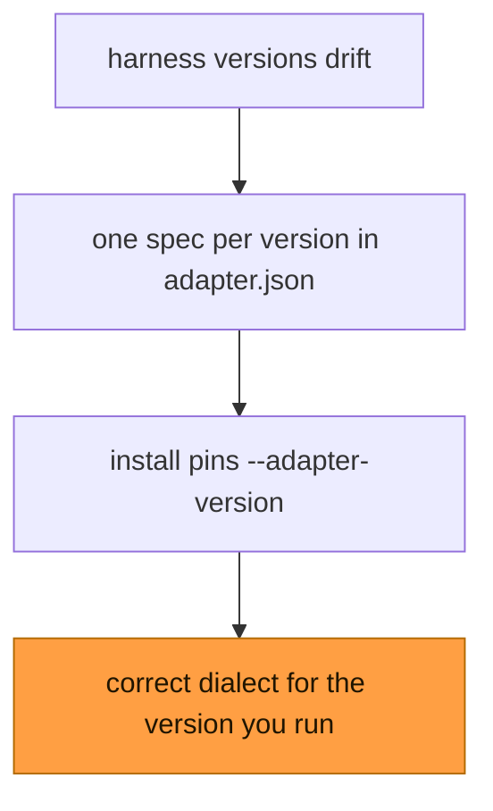

# Declarative Adapters — Field Research & Design (v2)

Supersedes the v1 sketch. v2 is grounded in the current hook documentation of all six
first-class harnesses (fetched 2026-09-03) and in the shipped code
(`crates/agent-hooks-adapters`, `crates/agent-hooks-cli/src/commands/install.rs`,
`crates/agent-hooks-core/src/daemon.rs`).

---

## 1. Problem Statement

Adding a harness adapter today requires:

1. **Rust knowledge + recompile** — every adapter is a hardcoded struct implementing
   `HarnessAdapter` (`crates/agent-hooks-adapters/src/*.rs`, 12 adapters).
2. **Version drift with no pinning** — payload shapes and config locations change
   under us. Real example already shipped: the installer table (`install.rs:73`)
   registers Cursor at `~/.cursor/settings.json`, but Cursor's current contract is a
   dedicated `hooks.json` (`{version: 1, hooks: {...}}`). Nothing detects the drift.
3. **Fragmented installer** — `install.rs` keeps a second, separate `HARNESSES` table
   that does not derive from the adapters, plus one-off staging code for the omp
   plugin (`install_omp_plugin`).
4. **Leaky normalization** — harness quirks leak into the daemon. Example:
   `daemon.rs:745-769` hardcodes "Antigravity observation events must print `{}`"
   because Antigravity's protojson rejects unknown fields. That is adapter knowledge
   living in the wrong layer.

Goal: **any company can support their agent harness by writing one JSON file plus a
handful of captured payload fixtures — no Rust, no fork, no recompile.**

---

## 2. Field Research: What Each Harness Actually Does

### 2.1 Comparison table

| | Claude Code | Cursor | Codex (ChatGPT) | Antigravity | Pi / omp | OpenCode |
|---|---|---|---|---|---|---|
| Hook config | `~/.claude/settings.json`, `.claude/settings.json`, `.claude/settings.local.json`, plugin `hooks/hooks.json` | `~/.cursor/hooks.json`, `<project>/.cursor/hooks.json` | `~/.codex/hooks.json` **or** inline `[hooks]` in `~/.codex/config.toml` (same for repo `.codex/`) | `.agents/hooks.json` (workspace), `~/.gemini/config/hooks.json` | none — TS extension files | none — plugin dir, stage-only (auto-loaded) |
| Entry nesting | 3-level: `hooks.<Event>[{matcher, hooks:[handler]}]` | 2-level flat: `hooks.<event>[{command, matcher, ...}]` | Claude-style 3-level | **named bundles**: `{"<name>": {enabled, <Event>: [...]}}` | n/a | n/a |
| Event name case | `PascalCase` (`PreToolUse`) | `camelCase` (`preToolUse`, `beforeShellExecution`) | `PascalCase` | `PascalCase` | `snake_case` (`tool_call`) | `dot.notation` (`tool.execute.before`) |
| Session id field | `session_id` | `conversation_id` | `session_id` (+ `turn_id`) | `conversationId` | ctx object | ctx object |
| Tool fields | `tool_name`, `tool_input` | `tool_name`, `tool_input` | `tool_name`, `tool_input`, `tool_response` | `toolCall.name`, `toolCall.args` | `event.toolName`, `event.input` | `input.tool`, `output.args` |
| Decision response | `hookSpecificOutput.{permissionDecision, permissionDecisionReason}` | `{permission: allow\|deny, user_message, agent_message, updated_input}` | `hookSpecificOutput` (Claude-shape) or legacy `{decision: "block", reason}` | `{decision: allow\|deny\|ask\|force_ask, reason, permissionOverrides}` | `return {block: true, reason}` | `throw` (tool/chat gates) · `output.status` allow\|deny\|ask (`permission.ask`) · out-of-band SDK reply (`question.asked`, persistent grants) |
| Block shortcut | exit 2 + stderr | exit 2 + stderr | exit 2 + stderr | — | — | — |
| Observation events | output discarded (SessionEnd) or context (`additionalContext`) | `{}` | plain stdout ignored on many events; JSON `{continue, systemMessage}` | **must print exactly `{}`** (protojson) | return value per event | return value per event |
| Trust gate | workspace trust dialog | trusted workspace for project hooks | **per-hook hash review in `/hooks`**; unreviewed hooks skipped | none documented | project trust | none |
| Default timeout | 30s; **SessionEnd 1.5s** | platform default | **600s; SessionEnd/Interrupt 1s (max 3s)** | 30s | n/a | n/a |
| Fail mode | fail-open | fail-open (`failClosed: true` opt-in) | fail-open | fail-open | tool_call errors block (fail-safe) | throw = block |

### 2.2 Per-harness contract cards

**Claude Code** — richest event set (30+: `SessionStart`, `SessionEnd`,
`UserPromptSubmit`, `PreToolUse`, `PostToolUse`, `PostToolUseFailure`,
`PermissionRequest`, `PermissionDenied`, `Notification`, `SubagentStart/Stop`,
`Stop`, `StopFailure`, `Pre/PostCompact`, `Pre/PostModelSwitch`, `Elicitation`, …).
Handlers: `command | http | mcp_tool | prompt | agent`. Snake_case stdin JSON:
`session_id`, `transcript_path`, `cwd`, `hook_event_name`. Hook entries merge across
all settings levels. SessionEnd has a 1.5s default timeout — our shim must answer
from cache/socket within that or the installer must write a larger `timeout`.

**Cursor** — dedicated `hooks.json` with `version: 1` and **flat** per-event arrays:
`{command, timeout, matcher, failClosed, loop_limit}`. camelCase events, but payload
fields are snake_case with a twist: session key is `conversation_id` (plus
`generation_id` per turn). Distinct per-event response shapes:
`preToolUse → {permission, user_message, agent_message, updated_input}`;
`beforeSubmitPrompt → {continue, user_message}`; `stop → {followup_message}`
(loop-capped auto-continue); `sessionStart → {env, additional_context}`. Exit 2
blocks. Config hot-reloads on save. Also ingests Claude-Code-style third-party
hooks, but native `hooks.json` is the stable path for us.

**Codex** — Claude-compatible 3-level config in *either* `hooks.json` *or* inline
`[[hooks.<Event>]]` TOML tables in `config.toml` (both merge). Handlers
`command | mcp_tool` (prompt/agent parsed but skipped). Payload adds `turn_id`,
`model`, `permission_mode`, `tool_response`. Responses: Claude-style
`hookSpecificOutput` plus legacy `{decision: "block", reason}`; `PermissionRequest`
uses `{hookSpecificOutput: {decision: {behavior: allow|deny, message}}}`;
`Stop` block semantics = "continue with reason as next prompt".
**Killer detail: trust.** Codex skips every non-managed hook until the user reviews
and trusts its exact hash in `/hooks`. The installer cannot silently register hooks —
it must print follow-up instructions. `--dangerously-bypass-hook-trust` exists for CI.

**Antigravity** — `SessionStart`, `PreToolUse`, `PostToolUse`, `PreInvocation`,
`PostInvocation`, `Stop`. `SessionStart` marks the conversation start;
`PreInvocation`/`PostInvocation` bracket model calls; `PreInvocation` is a user
prompt submission only when `invocationNum` is zero. `SessionEnd` is
unavailable. Named-bundle config: each top-level key is a hook group with its
own `enabled` flag. camelCase payload (`toolCall.{name,args}`,
`workspacePaths`, `transcriptPath`). Observation events require `{}` output
(protojson strictness — special-cased in `daemon.rs`).

**Pi / Oh My Pi** — no hook config surface at all. Extensions are TypeScript modules
auto-discovered from `~/.pi/agent/extensions/` (or omp: `~/.omp/plugins`, registered
via `omp plugin install`). Programmatic API: `pi.on("tool_call")` returning
`{block: true, reason}`, `tool_result` mutation, rich lifecycle events. This is why
we ship a staged bridge plugin (`builtin/pi/assets/oh-my-pi/index.ts`) that forwards events to
the daemon over the socket. The manifest must treat "stage files + run a
registration command" as a first-class install path.

**OpenCode** — also plugin-based, drop-in only. Stage one `.ts` file into
`~/.config/opencode/plugins/` or `.opencode/plugins/` (auto-loaded): no
registration command, no `json_edit`, no npm path. The repo-root
`opencode.json` is schema-only (`{"$schema": ...}`) — not a plugin list —
and the installer never touches it. Plugin = exported async function
returning hooks keyed by dotted event names. Full event map (from
`builtin/opencode/adapter.json`):

| Host event | Lifecycle | Capability | Reply path |
|---|---|---|---|
| `tool.execute.before` | `PreToolUse` | gate | `throw` to deny |
| `tool.execute.after` | `PostToolUse` | observe | fire-and-forget |
| `permission.ask` | `PermissionRequest` | gate (`allow`/`deny` verdicts) | in-band `output.status` (`allow`\|`deny`\|`ask`) |
| `question.asked` | `PermissionRequest` | gate (`allow`/`deny` verdicts) | out-of-band SDK `question.reply`/`reject` |
| `chat.message` | `UserPromptSubmit` | gate | `throw` to deny |
| `session.created` | `SessionStart` | observe | fire-and-forget |
| `session.updated` | `UserPromptSubmit` | observe | fire-and-forget |
| `session.deleted` | `SessionEnd` | observe | fire-and-forget |
| `session.idle` | `Stop` | observe | fire-and-forget |
| `question.replied` | `Notification` | observe | — |
| `permission.asked` | `Notification` | observe | — |
| `permission.replied` | `Notification` | observe | — |

Note `question.asked` (a gate — the bridge holds for the verdict, then
answers out of band) vs `permission.asked` (a mere `Notification`).
`permission.ask` keeps its native three-way `output.status`, and a
`reply: "allow_always"` verdict is delivered as a persistent grant through
the SDK because the in-band status cannot express it.

### 2.3 What this means for the manifest

The v1 sketch (json_config / toml_config / plugin_stage + per-event rename map +
allow/deny templates) under-models reality in five ways:

1. **Entry nesting is not one shape.** Claude/Codex use matcher-group nesting;
   Cursor is flat; Antigravity wraps everything in named bundles with an `enabled`
   flag. A single `target_path` + `template` cannot express all three idempotently.
2. **Response format is per event *class*, not per harness.** A harness's
   `PreToolUse` and its `postToolUse` speak different dialects (Cursor:
   `permission` vs `{}`; Antigravity: `{decision,...}` vs `{}`), and Codex
   `PermissionRequest` differs even from its own `PreToolUse`.
3. **Extraction needs dotted paths and per-event overrides** — `toolCall.name`
   (Antigravity), `conversation_id` vs `session_id`, `reason` vs
   `terminationReason` on Stop.
4. **Trust and post-install steps are part of the install.** Codex hooks do not run
   until reviewed; Claude gates on workspace trust. An installer that exits 0 after
   writing JSON and prints nothing lies to the user.
5. **Auto-detection needs declarative fingerprints** — today
   `AdapterRegistry::detect_from_input` hardcodes payload-sniffing per adapter.

---

## 3. Normalized Model (unchanged core, two additions)

`AgentLifecycle` stays the normalization target:
`SessionStart, SessionEnd, UserPromptSubmit, PreToolUse, PostToolUse,
PostToolUseFailure, PermissionRequest, Notification, SubagentStart, SubagentStop,
TurnStart, TurnEnd, Stop, PreCompact, PostCompact, Interrupt, PostToolBatch,
PreLLMCall, PostLLMCall, StopFailure, ToolUseStart`.

Two additions, both derived from the research:

1. **Capability classes.** Every host event maps to a lifecycle event *and* one of
   three decision capabilities, which select the response dialect:

   | Capability | Meaning | Examples |
   |---|---|---|
   | `gate` | can block/allow before the action | `PreToolUse`, `UserPromptSubmit`, `PermissionRequest`, `beforeShellExecution`, `beforeReadFile` |
   | `observe` | fire-and-forget; response is discardable or must be empty | `PostToolUse`, `sessionEnd`, `preCompact`, Antigravity `SessionStart` and `PostInvocation`; `PreInvocation` maps to `UserPromptSubmit` only when `invocationNum` is zero |
   | `continue` | can force the agent to keep going | `Stop`, `SubagentStop` (all harnesses that support it) |

2. **Availability.** A manifest declares which lifecycle events the harness *cannot*
   emit (Antigravity: no `SessionEnd`; Cursor: no `PermissionRequest`). `agent-hooks status` and docs
   render this truthfully instead of assuming all harnesses are equal.

---

## 4. Manifest Specification v2 (`adapter.json`)

### 4.1 Top level

```json
{
  "$schema": "https://raw.githubusercontent.com/<org>/agent-hooks/main/schemas/adapter-manifest.v1.json",
  "id": "cursor",
  "display_name": "Cursor",
  "aliases": ["cursor-agent", "cursor-cli"],
  "default_version": "v1",
  "min_agent_hooks": "0.3.0",
  "detect": {
    "harness_hint": ["cursor"],
    "payload_keys_any": [["cursor_version"], ["workspace_roots"]],
    "event_names": ["beforeSubmitPrompt", "sessionStart"]
  },
  "versions": {
    "v1": {
      "install": ["...InstallOp..."],
      "events": {},
      "extraction": {},
      "extraction_overrides": {},
      "response": {},
      "unavailable": [],
      "notes": { "post_install": ["Restart Cursor or save hooks.json to hot-reload."] }
    }
  }
}
```

Manifests load with `serde(deny_unknown_fields)` and validate against the published
JSON Schema. Unknown fields are a hard error with a pointer — silent-typo adapters
are the #1 future support burden, so the loader refuses to guess.

### 4.2 Install operations

`install` is an **ordered list of ops**. Five ops cover all six harnesses; anything
future harnesses need is far more likely to be a parameter than a sixth op.

#### Op 1: `json_hooks` — write hook entries into a JSON config

```json
{
  "op": "json_hooks",
  "paths": ["~/.cursor/hooks.json", ".cursor/hooks.json"],
  "create": true,
  "root": "hooks.{event}",
  "entry_shape": "flat",
  "fixed_fields": { "version": 1 },
  "entry": { "command": "{command}", "timeout": 10 },
  "dedupe": "command_subset",
  "entry_overrides": { "stop": { "loop_limit": 10 } }
}
```

- `root`: dotted path to the per-event array; `{event}` interpolates the **host**
  event name.
- `entry_shape`:
  - `flat` → array entries are the handler objects (Cursor).
  - `matcher_group` → each event's array becomes `[{ "matcher": "*", "hooks":
    [handler] }]` (Claude, Codex). The matcher is always `"*"` (match
    everything) — there is no per-matcher narrowing; narrow with local-hook
    `when` filters instead.
  - `named` → same wrapped shape as `matcher_group`, but entries live under a
    named group key: `root: "{name}.{event}"`, `name: "agent-hooks"`
    (Antigravity; defaults to `"agent-hooks"` when `name` is omitted). The
    group object gets `"enabled": true` when missing.
- `entry.command`: overwritten with the canonical hook command (current binary
  path + socket + adapter version) unless the template embeds `{command}`
  inside a larger custom command. `{event}` interpolates the host event in any
  string. Reinstalls prune stale same-harness entries (e.g. an old binary
  path), drop matcher groups left empty, and never touch foreign entries.
- `fixed_fields`: written once at the JSON root if missing (Cursor's `version: 1`).
- `entry_overrides`: per-event handler tweaks (Codex `SessionEnd` timeout 3,
  Claude `SessionEnd` timeout 5 to lift the 1.5s default).
- `dedupe`: `command_subset` (skip if an entry with the same command already
  exists) — makes reinstall idempotent, matching today's behavior.

Worked outputs:

Claude Code (`entry_shape: matcher_group`, `root: "hooks.{event}"`):

```json
{ "hooks": { "PreToolUse": [ { "matcher": "*", "hooks": [
  { "type": "command", "command": "agent-hooks hook claude --event PreToolUse" } ] } ] } }
```

Cursor (`entry_shape: flat`, `fixed_fields: {"version": 1}`):

```json
{ "version": 1, "hooks": { "preToolUse": [
  { "command": "agent-hooks hook cursor --event preToolUse", "timeout": 10 } ] } }
```

Antigravity (`entry_shape: named`, `name: "agent-hooks"`):

```json
{ "agent-hooks": { "enabled": true, "PreToolUse": [
  { "matcher": "*", "hooks": [
    { "type": "command", "command": "agent-hooks hook antigravity --event PreToolUse" } ] } ] } }
```

#### Op 2: `toml_hooks` — inline hook tables in a TOML config

For Codex's `config.toml` representation:

```json
{
  "op": "toml_hooks",
  "paths": ["~/.codex/config.toml"],
  "create": true,
  "root": "hooks.{event}",
  "entry_shape": "matcher_group",
  "entry": { "type": "command", "command": "{command}", "timeout": 30 }
}
```

Emits `[[hooks.PreToolUse]]` / `[[hooks.PreToolUse.hooks]]` tables via `toml_edit`
(format- and comment-preserving; Windows paths escaped — `toml_escape` already
exists in `install.rs`).

#### Op 3: `stage_assets` — write bundled files to a directory

```json
{
  "op": "stage_assets",
  "stage_dir": "$XDG_DATA_HOME/agent-hooks/plugins/oh-my-pi",
  "assets": [
    { "path": "package.json", "embedded": "oh-my-pi/package.json" },
    { "path": "index.ts", "embedded": "oh-my-pi/index.ts" }
  ],
  "managed_marker": "//! managed by agent-hooks"
}
```

- `embedded`: key into the binary's embedded asset table, resolved as
  `builtin/<id>/assets/<key>` at build time via `include_str!` (unknown keys
  are an install error naming the expected path). This is how the omp bridge
  ships inside the binary.
- `template`: inline content alternative — a verbatim string, or arbitrary JSON
  pretty-printed. Staged **byte-identical**: no placeholder substitution happens
  here. A bridge needing the socket or binary path must discover it at runtime
  (env / convention), not at install time.
- `managed_marker`: source-comment prefix prepended to non-JSON code assets
  (never to `.json` — it would corrupt them). This is how `status` counts and
  `uninstall` recognizes our files in shared plugin dirs.
- Covers omp staging **and** OpenCode drop-in (`stage_dir: "~/.config/opencode/plugins"`),
  and any future dir-scan harness — no separate op needed. OpenCode is
  stage-only: no `run_command`, no `json_edit`.

#### Op 4: `run_command` — register the staged plugin

```json
{ "op": "run_command", "command": "omp plugin install {stage_dir}", "optional": true }
```

`optional: true` → if the binary is missing, print `notes.post_install` and succeed
(today's `print_omp_manual` behavior). Uninstall replays recorded commands in
reverse where a reverse is declared (`"undo": "omp plugin remove agent-hooks"`).
OpenCode and Pi declare no `run_command` — their staged dirs are auto-loaded.

#### Op 5: `json_edit` — non-hook config mutation

For harnesses that need a scalar flag flipped alongside hooks:

```json
{
  "op": "json_edit",
  "paths": ["<config>.json"],
  "pointer": "/some_flag",
  "mode": "set",
  "value": true
}
```

`mode`: `append_unique | set | remove`. Never used for plugin drop-ins —
no builtin uses it: OpenCode's `opencode.json` is schema-only and the
installer never touches it; there is no npm plugin path.

### 4.3 Event map

```json
{
"events": {
  "sessionStart":        { "lifecycle": "SessionStart",      "capability": "observe" },
  "sessionEnd":          { "lifecycle": "SessionEnd",        "capability": "observe" },
  "beforeSubmitPrompt":  { "lifecycle": "UserPromptSubmit",  "capability": "gate" },
  "preToolUse":          { "lifecycle": "PreToolUse",        "capability": "gate" },
  "postToolUse":         { "lifecycle": "PostToolUse",       "capability": "observe" },
  "postToolUseFailure":  { "lifecycle": "PostToolUseFailure","capability": "observe" },
  "subagentStart":       { "lifecycle": "SubagentStart",     "capability": "gate" },
  "subagentStop":        { "lifecycle": "SubagentStop",      "capability": "continue" },
  "stop":                { "lifecycle": "Stop",              "capability": "continue" }
}
}
```

`unavailable` lists lifecycle events the harness can never emit:

```json
{
"unavailable": ["PermissionRequest", "Notification", "TurnStart", "TurnEnd"]
}
```

(Antigravity additionally lacks both session events; Pi and OpenCode map their
programmatic events through the bridge plugin, so *their* manifests carry the
plugin-side event map in `stage_assets` templates and the manifest's `events` map
describes the bridge's wire events.)

### 4.4 Extraction

Candidate lists walk in priority order; **dotted paths walk nested objects
strictly**, bare keys keep today's recursive fallback (`extract_string_field`
inspects top-level keys and `payload`/`params`/`info`/`data` envelopes):

```json
{
"extraction": {
  "session_id":  ["conversation_id", "session_id", "sessionId", "conversationId"],
  "prompt":      ["prompt", "user_prompt", "message", "input"],
  "tool_name":   ["tool_name", "toolCall.name"],
  "tool_input":  ["tool_input", "toolCall.args", "args"],
  "tool_output": ["tool_output", "tool_response", "result_json", "output"],
  "error":       ["error_message", "error", "failure_type"],
  "success":     ["success"]
}
}
```

Per-event overrides for fields whose meaning shifts by event:

```json
{
"extraction_overrides": {
  "Stop": { "summary": ["reason", "terminationReason"] }
}
}
```

### 4.5 Response

Keyed by capability, because that is the axis along which harness dialects actually
differ. Values are JSON templates; `{reason}` interpolates the deny/continue reason,
`{event}` the host event name, `{answers}` the flattened comma-joined picks,
`{reply}` the normalized reply verb (`allow`/`allow_always`/`deny`/`ask`),
`{answer_groups}` the structured per-question picks (`string[][]`).

```json
{
"response": {
  "mode": "json",
  "gate": {
    "allow": { "permission": "allow" },
    "deny":  { "permission": "deny", "user_message": "{reason}", "agent_message": "{reason}" }
  },
  "observe": {},
  "continue": {
    "continue": { "followup_message": "{reason}" },
    "stop": {}
  },
  "empty_on_undecided": true
}
}
```

More dialects:

Claude Code / Codex (gate):

```json
{
"gate": {
  "allow": { "hookSpecificOutput": { "hookEventName": "{event}", "permissionDecision": "allow" } },
  "deny":  { "hookSpecificOutput": { "hookEventName": "{event}", "permissionDecision": "deny",
                                     "permissionDecisionReason": "{reason}" } }
}
}
```

Antigravity (gate + the `{}` rule that deletes `daemon.rs:745-769`):

```json
{
"gate": {
  "allow": { "decision": "allow" },
  "deny":  { "decision": "deny", "reason": "{reason}" }
},
"observe": {},
"continue": { "continue": { "decision": "continue", "reason": "{reason}" }, "stop": {} }
}
```

OpenCode `PermissionRequest` override (structured answers + persistent grants):

```json
{
"response_overrides": {
  "PermissionRequest": {
    "allow": { "decision": "allow", "reply": "{reply}", "answers": "{answer_groups}" },
    "deny":  { "decision": "deny", "reply": "deny", "reason": "{reason}" },
    "ask":   { "decision": "ask", "reply": "ask", "reason": "{reason}" }
  }
}
}
```

The bridge delivers these out of band: `answers` go through the SDK
`question.reply` call (the hook return cannot carry them), and
`reply: "allow_always"` becomes a persistent grant via `permission.reply`.

- `mode: "exit2"` for harnesses where blocking is a process exit code: deny →
  `exit(2)` with reason on stderr (shared by Claude, Cursor, Codex — useful as a
  universal fallback when a JSON dialect is undocumented).
- `empty_on_undecided: true` → print nothing (or `{}`) when the daemon has no
  decision; the default `FALLBACK_ALLOW` (`{"decision":"allow"}`) is replaced by
  the manifest's `gate.allow` template rendered with the daemon's timeout policy.
- Per-event response overrides ride on `entry_overrides`-style keys
  (`response_overrides`) for oddities like Codex `PermissionRequest`'s
  `decision.behavior` shape.

### 4.6 Detection

Declarative fingerprints replace the hardcoded ladder in
`AdapterRegistry::detect_from_input` (hint match → camelCase/dot heuristics →
per-adapter `matches_input` → payload keys):

```json
{
"detect": {
  "harness_hint": ["cursor"],
  "payload_keys_any": [["cursor_version"], ["workspace_roots"]],
  "event_names": ["beforeSubmitPrompt", "sessionStart", "afterFileEdit"]
}
}
```

- `harness_hint`: matches the shim's `--harness`/positional hint (highest priority).
- `payload_keys_any`: ordered OR-groups — if any key in group 1 exists, score high;
  group 2 lower, etc. (Antigravity: `[["conversationId", "workspacePaths"]]`;
  Claude: `[["transcript_path", "hook_event_name"]]` — ambiguous keys like
  `session_id` score last).
- `event_names`: known host event names found in `hook_event_name` / `event_hint`.
- Ties break by manifest specificity (more matched groups wins), then embedded
  order. Detection results are logged with the winning fingerprint so mis-sniffs
  are debuggable from `agent-hooks status`.

---

## 5. The "Any Company" Developer Workflow

This is the part that makes extensibility real. Writing an adapter must be a
one-afternoon job with verification that does not require the company's harness to
be installed on our machines.

```bash
# 1. Scaffold
agent-hooks adapter new myagent          # writes ~/.config/agent-hooks/adapters/myagent.json + fixtures/

# 2. Capture real payloads from the harness while it runs
agent-hooks capture --event PreToolUse   # wraps `agent-hooks hook` and saves stdin to fixtures/

# 3. Paste 2-3 captured payloads into fixtures/, annotate expectations
#    (fixtures/myagent-pretooluse.json: { "stdin": {...}, "expect_event": {...}, "expect_response": {...} })

# 4. Validate + replay offline
agent-hooks adapter validate myagent     # JSON Schema + structural checks
agent-hooks adapter test myagent         # replays every fixture through parse_event + format_response

# 5. Install against the real harness
agent-hooks install --harness myagent
```

- `adapter test` runs **without the daemon or the harness present** — fixtures are
  the conformance suite. A company can CI their manifest.
- `adapter validate` enforces: schema conformance, every `events` value maps to a
  known lifecycle, install paths expand, install ops produce parseable output
  (dry-run JSON/TOML patch against a temp copy), response templates render with
  sample decisions.
- Upstream contribution path: PR the manifest into this repo's
  `crates/agent-hooks-adapters/builtin/<id>/adapter.json` (embedded at compile time via the same
  `include_str!` mechanism the omp plugin uses today) — or just tell users to drop
  the file into `~/.config/agent-hooks/adapters/`.

### Discovery priority (unchanged from v1)

1. Project: `.agent-hooks/adapters/*.json`
2. User: `~/.config/agent-hooks/adapters/*.json`
3. Embedded: `crates/agent-hooks-adapters/builtin/<id>/adapter.json`

Project beats user beats embedded, so a repo can pin a corrected manifest before an
upstream release ships. `agent-hooks adapter add <path|git-url|tarball-url>` copies
an external manifest into the user dir and records `{source, sha256, fetched_at}`
in a sidecar `<id>.meta.json` (JSON has no comment syntax, so provenance is a
sidecar, not in-band).

### Version pinning (unchanged from v1)

Installer stamps `--adapter-version v1` into the registered command; `hook` resolves
the pinned `VersionSpec`; missing flag → `default_version` → structural sniff.
`min_agent_hooks` gates manifests that need newer runtime features (e.g.
`exit2` response mode), failing install with an upgrade message instead of
misbehaving at event time.

---

## 6. Runtime Resolution



```mermaid
flowchart TB
    FIRE["harness fires hook"] --> NORM["normalize to AgentEvent"]
    NORM --> SEND["daemon decides"]
    SEND --> BACK["harness-dialect reply"]
    SEND -.->|side-channel SDK reply (OpenCode question.asked, persistent grants)| BACK
    SEND --> APPS2["every app sees the same event"]
    classDef core fill:#ff9f43,stroke:#b26a00,color:#201500
    class SEND core
```

```
host fires hook
  → agent-hooks hook <id> --event <host-event> [--adapter-version v1]
      → AdapterRegistry.get(id)            # manifest tiers, alias-normalized
      → DeclarativeAdapter(VersionSpec)
      → parse_event: extraction + events map → AgentEvent (lifecycle + capability)
      → dispatch over socket → daemon (unchanged wire protocol)
      → decision (PromptDecision) → response[capability] template → stdout
```

`DeclarativeAdapter` implements the existing `HarnessAdapter` trait —
`parse_event`, `format_response`, `hook_definitions`, `matches_input` all become
manifest-driven. All adapters are declarative; the registry
holds `Vec<Box<dyn HarnessAdapter>>` either way.

---

## 7. Migration Plan

1. **Manifest types** — `AdapterManifest`, `VersionSpec`, `InstallOp` (the 5 ops),
   `EventSpec`, `ExtractionSpec`, `ResponseSpec`, `DetectSpec` in
   `crates/agent-hooks-adapters/src/manifest.rs`; `deny_unknown_fields`; JSON
   Schema file at `schemas/adapter-manifest.v1.json` + loader-side validation.
2. **`DeclarativeAdapter`** — landed (implements `HarnessAdapter` off a
   `VersionSpec`; reuses `extract_string_field` / `extract_session_id` /
   `payload_value` primitives; adds dotted-path walking).
3. **Port the four shape-representative adapters first** — landed
   (claude matcher_group, cursor flat, antigravity named + `{}` observe,
   codex hooks.json + toml inline + trust notes). Their existing fixture tests
   (`crates/agent-hooks-adapters/tests/adapters_fixture_tests.rs`) became the
   fixture format seed.
4. **Installer from manifests** — landed (op execution replaced `HARNESSES` +
   `install_json_hooks` / `install_toml_hooks` / `install_omp_plugin`, with
   `hook_command` stamping and `notes.post_install` printing — Codex `/hooks`
   trust, omp manual steps).
5. **Delete the daemon special case** — landed (Antigravity `{}` observation
   lives in the manifest's `observe: {}`, not in `daemon.rs`).
6. **Port remaining adapters** — landed: every harness ships as
   `builtin/<id>/adapter.json` and no per-harness Rust adapters remain
   (the engine is `DeclarativeAdapter` + manifests only).
7. **Adapter CLI** — landed (`adapter new | validate | test | add | list`;
   `capture` flag on `hook`).
8. **Flags** — landed (`--adapter-version` on `install` and `hook`).

All ports landed: every harness ships as `builtin/<id>/adapter.json` and no
per-harness Rust adapters remain (the engine is `DeclarativeAdapter` +
manifests only). Steps 1-2 were mechanical; step 5 was the first
user-visible simplification; step 3 was where correctness risk concentrated
(response dialects), fenced by the fixture tests.

---

## 8. Non-Goals

- No remote manifest registry/service — filesystem tiers + `adapter add` cover
  distribution; a git index in this repo is enough.
- No generic scripting inside manifests (no WASM/Lua escape hatch). If a harness
  needs real code, it needs a bridge plugin (the Pi/OpenCode pattern) — ship it via
  `stage_assets`, not by embedding an interpreter.
- No per-event response *logic*, only templates. Conditionality stays in the daemon.
