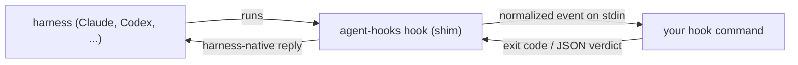

# Embedding agent-hooks in an app

agent-hooks is a dependency like `git` or `ffmpeg`: your app makes sure the binary exists, then integrates by **registering a hook command**. No daemon, socket client, or crate is involved.



Three steps:

1. **Get the binary and register the shim** in every harness: `agent-hooks self-install` (one call; SDKs below wrap it).
2. **Register your command** in `~/.agent-hooks/hooks.json` (or a project's `.agent-hooks/hooks.json`).
3. **Read the event** on stdin; optionally answer it.

## 1. Get the binary

`self-install` copies the running binary to the shared path (`~/.agent-hooks/bin/agent-hooks`, or `$AGENT_HOOKS_HOME/bin`), registers hooks in detected harnesses, and is idempotent: the newest version wins, so several apps can each call it on every launch. Hooks live in other tools' configs, so the binary must sit at a stable path that outlives your app.

| Your app is | Use | Binary comes from |
| :-- | :-- | :-- |
| Node / Electron | `npm i builtby.win-agent-hooks`, then `await init()` | per-platform npm packages (`optionalDependencies`, no postinstall) |
| Python | `pip install builtby-win-agent-hooks`, then `init()` | platform wheels that contain the binary |
| Go | `agenthooks.Init(ctx, opts)` from `sdk/go` | downloaded from the release, sha256-verified, on first use |
| Rust, Swift, native, shell, anything else | run the bootstrap one-liner below on launch (or first use of the feature) | release assets, via `install.sh` / `install.ps1` |

> Package names: `agent-hooks` is taken on both npm and PyPI by unrelated projects. npm: `builtby.win-agent-hooks`; PyPI: `builtby-win-agent-hooks` (PyPI normalizes `.` and `-`, so `builtby.win-agent-hooks` is the same project); Python import name `builtby_win_agent_hooks`.

### Bootstrap (any language)

No SDK needed. Check first, install only if missing or too old, so a launch with no network still works:

```sh
# 1. Present and new enough? Use it directly (no network). Fails if absent or too old.
ah="${AGENT_HOOKS_HOME:-$HOME/.agent-hooks}/bin/agent-hooks"
{ [ -x "$ah" ] && "$ah" self-install --min-version 0.13.0 --json; } ||
# 2. Otherwise bootstrap (fetches install.sh, then the release asset):
  curl -fsSL https://github.com/builtby-win/agent-hooks/releases/latest/download/install.sh | sh -s -- --min-version 0.13.0 --json
```

Step 2 alone is also idempotent: `install.sh` reuses an installed copy that meets `--min-version` without downloading the binary, but it still fetches `install.sh` itself, so do not make it the only path on launches that may be offline. Windows (PowerShell): `$env:AGENT_HOOKS_MIN_VERSION='0.13.0'; $env:AGENT_HOOKS_JSON=1; irm https://github.com/builtby-win/agent-hooks/releases/latest/download/install.ps1 | iex`.

Flags: `--min-version X.Y.Z`, `--json`, `--harness <id|all>`, `--no-hooks`. Env: `AGENT_HOOKS_VERSION` to pin, `AGENT_HOOKS_HOME` to relocate, `AGENT_HOOKS_BASE_URL` for a mirror.

**Scope.** `self-install` only touches user-level harness configs (under `~`, `$XDG_*`). It never writes cwd-relative project configs such as `.github/hooks/hooks.json`, so it is safe to run from any cwd. The separate `agent-hooks install` command does include project configs.

**GUI hosts and `PATH`.** A harness counts as detected only when its CLI is on `PATH`. Apps launched from Finder, launchd or a dock inherit a minimal `PATH` (`/usr/bin:/bin:/usr/sbin:/sbin`), so the result will have `harnesses: []` even with Claude or Codex installed. Run the bootstrap through the user's login shell (`$SHELL -lc '…'`) or pass `--harness <id>` for the harnesses you care about.

### The contract (what the one-liner does)

1. Pick the asset for the machine: `agent-hooks-<triple>.tar.gz` (`.zip` on Windows) from `https://github.com/builtby-win/agent-hooks/releases/latest/download/` (or `/download/<tag>/`). Triples: `aarch64-apple-darwin`, `x86_64-apple-darwin`, `aarch64-unknown-linux-musl`, `x86_64-unknown-linux-musl` (static; runs on glibc and musl), `aarch64-pc-windows-msvc`, `x86_64-pc-windows-msvc`.
2. Download the sibling `.sha256` and verify before running anything. Extract `agent-hooks-<triple>/agent-hooks[.exe]`.
3. Run it: `agent-hooks self-install --json [--harness <id|all>] [--min-version X.Y.Z] [--no-hooks] [--socket PATH]`.
4. Parse the **last stdout line** as JSON (the hook installer prints human text above it):

   ```json
   {"path":"/Users/me/.agent-hooks/bin/agent-hooks","action":"installed","version":"0.13.0","harnesses":[{"id":"claude-code","status":"installed"}],"on_path":false}
   ```

   `action` is `installed`, `upgraded`, `kept` (a newer-or-equal copy already existed) or `current` (you ran the shared copy). `harnesses` has one entry per detected harness with `status` `installed`, `current` (already up to date), `skipped` (no config file) or `failed` (plus `error`); it is empty when no harness CLI was found on `PATH` or with `--no-hooks`. Judge "are hooks active" from `harnesses`, not from `action`. From then on invoke the binary via `path`.

Sandboxed apps that cannot write to `~/.agent-hooks` should degrade gracefully (disable the feature, explain why) or ask the user to run the install line once. `self-install` edits other tools' config files, so surface that in your setup flow, or pass `--no-hooks` to only place the binary.

## 2. Register your command

**Drop in a plugin directory, one per app.** `~/.agent-hooks/plugins/<your-app>/plugin.json` maps **normalized** event names to commands, the same for every harness:

```json
{
  "name": "myapp",
  "version": "1.0.0",
  "hooks": {
    "UserPromptSubmit":  [{ "command": "myapp agent-event || true" }],
    "PostToolUse":       [{ "command": "myapp agent-event || true" }],
    "PermissionRequest": [{ "command": "myapp agent-event || true" }],
    "Stop":              [{ "command": "myapp agent-event || true" }],
    "SessionEnd":        [{ "command": "myapp agent-event || true" }]
  }
}
```

- Write your own file (or `agent-hooks plugin install <dir> --force`, which is idempotent). You never edit a file other apps share, so there is nothing to race and uninstalling is `rm -r` of your directory. A plugin that fails to parse is skipped on its own and does not affect other apps.
- Avoid the shared `~/.agent-hooks/hooks.json` for app integrations: it is one file with strict parsing, so a single unknown field in any entry makes the whole file ignored (warning on stderr only), silently disabling every app's hooks in it. It is for the user's own hooks.
- Plugin commands run as `(cd <plugin-dir> && <command>)` via `sh -c`, so the working directory is your plugin directory, not the agent's cwd; read the cwd from the event's `context.cwd`. `|| true` is POSIX shell; the plugin wrapper and `|| true` have not been tested on Windows (`cmd /C`), where a launcher script that always exits 0 is the safe form.
- Plugin and user entries, and every project tier, all run in parallel. Verdicts merge deny > ask > allow, so apps do not conflict as long as each only denies what it means to.
- **Exit codes are verdicts, not fail-open.** Exit `2` is deny and `3` is ask; malformed `allow` JSON and stdout over 1 MiB are deny. Only spawn errors, timeouts and other exit codes are fail-open. CLIs written with clap or argparse exit `2` on a usage error, so a status reporter whose arguments drift would deny every matched gating event (`PreToolUse`, `PermissionRequest`). A reporter that never decides should end with `|| true` (as above), or register only on non-gating events. Full schema: [Local hooks reference](../README.md#local-hooks-reference).

## 3. Read the event, answer if you want to

Your command receives the normalized `AgentEvent` JSON on **stdin** plus `AGENT_HOOKS_EVENT`, `AGENT_HOOKS_SESSION`, `AGENT_HOOKS_HARNESS` in the environment. Fields you will use:

| Field | Meaning |
| :-- | :-- |
| `harness`, `session_id` | which agent, which session |
| `lifecycle.type` / `lifecycle.data` | `PreToolUse`, `PermissionRequest`, `Stop`, ... plus tool name/input, prompt text |
| `status` | derived per event: `idle`, `running`, `waiting_for_input`, `failed`, `closed` (`completed` is reserved) |
| `context` | `cwd`, `tty`, `pid`, terminal/multiplexer ids, and allowlisted env such as `HERDR_PANE_ID`, `TMUX_PANE`, `KITTY_WINDOW_ID` |

**Status needs no daemon.** `status` is a pure function of the event, so a hook that reads it always has the current state for that session. The daemon only adds aggregation across processes.

**Answering.** Exit `0` = allow (stdout may carry a canonical decision such as `{"allow":false,"custom_input":"reason"}` or `{"additional_context":"..."}`), `2` = deny (stderr = reason), `3` = ask. Your command is a full decider: it can wait on a human (open a window, call your app, prompt a terminal) before exiting, and the shim returns the verdict in the harness's own dialect. The wait is bounded by the harness hook window; the installer writes gate-event windows above ~330s. Helpers: `agent-hooks answer --return --allow | --deny REASON | --select QID LABEL`. See [Answering prompts from apps](../README.md#answering-prompts-from-apps).

### Example: Herdr

Illustrative sketch; not run against Herdr. Flags follow Herdr's [Add Herdr support](https://herdr.dev/tui/docs/add-herdr-support/) docs. The hook runs inside the pane, so Herdr's own CLI resolves the pane from the pane environment. `herdr agent-event` reduces to:

```sh
#!/bin/sh
# Only report inside Herdr; do nothing elsewhere.
[ "$HERDR_ENV" = 1 ] && [ -n "$HERDR_PANE_ID" ] && [ -n "$HERDR_BIN_PATH" ] || exit 0
ev=$(cat)
# --seq must strictly increase per --source, or Herdr drops the report. The event's
# millisecond timestamp works; `date +%s` does not (two reports in one second collide).
seq=$(printf '%s' "$ev" | jq -r .timestamp_ms)
case "$(printf '%s' "$ev" | jq -r .status)" in
  running)           state=working ;;
  waiting_for_input) state=blocked ;;
  idle)              state=idle ;;
  closed)            "$HERDR_BIN_PATH" pane release-agent "$HERDR_PANE_ID" --source agent-hooks --agent "$AGENT_HOOKS_HARNESS" --seq "$seq" >/dev/null 2>&1 & exit 0 ;;
  *)                 exit 0 ;;
esac
"$HERDR_BIN_PATH" pane report-agent "$HERDR_PANE_ID" --source agent-hooks \
  --agent "$AGENT_HOOKS_HARNESS" --state "$state" --seq "$seq" >/dev/null 2>&1 &
exit 0
```

Herdr asks integrations to report under their own agent name, not that of an agent Herdr already supports natively (`claude`, `codex`, ...). Decide per harness whether Herdr's built-in integration or this one owns it, or two sources will fight over one pane.

### Example: cmux

Illustrative sketch; not run against cmux. cmux sets `CMUX_WORKSPACE_ID` / `CMUX_SURFACE_ID` in its terminals and its CLI targets the calling surface by default. `cmux set-status KEY VALUE` shows a sidebar pill and `cmux notify` lights the pane ring and notification panel. `cmux agent-event` reduces to:

```sh
#!/bin/sh
# Only report inside cmux; do nothing elsewhere.
command -v cmux >/dev/null 2>&1 && [ -n "$CMUX_SURFACE_ID" ] || exit 0
key="agent-$AGENT_HOOKS_HARNESS"
case "$(jq -r .status)" in
  running)           cmux set-status "$key" Running ;;
  waiting_for_input) cmux set-status "$key" "Needs input" --color "#ff9500"
                     cmux notify --title "$AGENT_HOOKS_HARNESS" --subtitle Waiting --body "Agent needs input" ;;
  idle)              cmux set-status "$key" Idle ;;
  closed)            cmux clear-status "$key" ;;
esac >/dev/null 2>&1
exit 0
```

cmux's default socket mode is "cmux processes only": it works here because the hook is a descendant of the agent's terminal, but an out-of-terminal consumer (a separate app or daemon) cannot reach the socket unless the user sets `CMUX_SOCKET_MODE=allowAll`. cmux can also run `notifications.hooks` in `cmux.json`, which see an `agent.kind` / `agent.category` for agent completions; that is cmux's own channel and independent of this one.

Both sketches run in the pane, take no daemon, and exit immediately so they never slow the agent. An app that resolves targets from outside the pane (for example a launcher reading the shim's forwarded `context`) should derive them from the mux's live events and the client tty rather than from these env vars.

## When you do need the daemon

Only for: a **push stream** to a long-lived subscriber (`subscribe` over the socket), **aggregated session state** across processes, or an **answerer that is a separate process** from the hook (`agent-hooks answer SESSION_ID`, UI deciders). See [Daemon + socket protocol](../README.md#daemon--socket-protocol) and [`socket-protocol.md`](socket-protocol.md).
