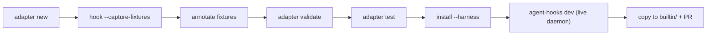
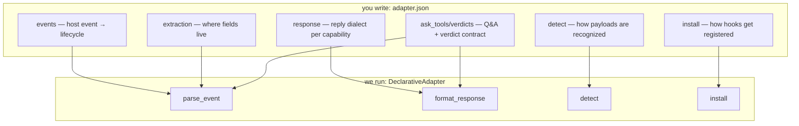

# Onboard a New Harness onto agent-hooks

One engine (`DeclarativeAdapter`), one JSON file per harness. Pure JSON
covers events, extraction, responses, verdicts, and question shapes. Rust is
needed only for (a) plugin-based harnesses (a bridge file via
`stage_assets`) and (b) lifecycle concepts that don't exist yet
(10-minute recipe in §7 — just proven adding codex PreCompact/PostCompact).

Source of truth: `docs/declarative-adapters-design.md` §4–§6,
schema `schemas/adapter-manifest.v1.json`,
examples `crates/agent-hooks-adapters/builtin/<id>/adapter.json`
(`cursor/` = flat, `claude-code/` = matcher_group + overrides,
`antigravity/` = named + `{}` observe, `codex/` = json+toml + trust
notes, `omp/` = stage_assets + run_command,
`opencode/`/`pi/` = stage-only stage_assets, no run_command).



What each manifest section does at runtime:



## 1. Scaffold (or extend)

```bash
agent-hooks adapter new <id>   # id: lowercase, digits, '-'/'_'
# writes ~/.config/agent-hooks/adapters/<id>.json + fixtures/
agent-hooks adapter list       # confirm builtin | user | project tiers
```

If the harness resembles a builtin, skip the 120-line scaffold — extend it:

```json
{"id": "myharness", "display_name": "My Harness", "extends": "claude-code",
 "default_version": "v1", "versions": {"v1": {"events": {
   "my_before_tool": {"lifecycle": "PreToolUse", "capability": "gate"}}}}}
```

`extends` inherits everything; local maps merge per-key (you win), other
fields replace only when present. Cycles and unknown bases are errors.
Resolved output is materialized (`extends: None`).

Read the closest builtin first: flat (`builtin/cursor/adapter.json`) vs
matcher_group (`builtin/claude-code/adapter.json`) vs named bundles
(`builtin/antigravity/adapter.json`) vs TOML (`builtin/jcode/adapter.json`)
vs plugin staging (`builtin/omp/adapter.json` stage + run_command,
`builtin/opencode/adapter.json` / `builtin/pi/adapter.json` stage-only,
no run_command).

## 2. Capture real payloads

```bash
echo '<real harness payload json>' | agent-hooks hook <id> --event <HostEvent> --capture-fixtures ~/.config/agent-hooks/adapters/fixtures/
# writes fixtures/<id>-<event>-<unixts>.json = {"harness","event_hint","stdin"}
```

Capture at minimum: one gate event (PreToolUse / beforeSubmitPrompt),
one observe event (PostToolUse / sessionEnd), one continue event (Stop) —
plus any harness-specific oddity (session-less events, camelCase keys,
nested `toolCall.name`). For pi-vs-omp style siblings, capture from EACH
and diff before deciding union vs `extends` child.

## 3. Annotate fixtures

Each fixture is `{stdin, expect_event, decision, expect_response}`:

```json
{
  "stdin": { "session_id": "abc", "tool_name": "Edit", "tool_input": {} },
  "expect_event": { "type": "PreToolUse", "session_id": "abc" },
  "decision": { "allow": false, "custom_input": "no rm -rf" },
  "expect_response": { "decision": "deny", "reason": "no rm -rf" }
}
```

`expect_event.type` is the normalized `AgentLifecycle` variant
(SessionStart, SessionEnd, UserPromptSubmit, PreToolUse, PostToolUse,
PostToolUseFailure, PermissionRequest, Notification, SubagentStart,
SubagentStop, TurnStart, TurnEnd, Stop, PreCompact, PostCompact, Interrupt,
PostToolBatch, PreLLMCall, PostLLMCall, StopFailure, ToolUseStart).
`expect_response` is the exact harness-dialect JSON.

Fill in the manifest to make them pass:
- `events`: host-event → `{lifecycle, capability: gate|observe|continue}`
  (+ optional `verdicts: [allow, deny, ask]` declaring exactly what the
  host honors — absent means all; ask on a non-ask event fails safe to
  deny; `adapter validate` errors on ask-template/verdict contradictions).
  For `Stop` events, `demote_when: {"<key>": <value>}` demotes to
  `TurnEnd` (status stays Running) when the payload matches — for
  weak stops where the agent isn't actually done (antigravity:
  `{"fullyIdle": false}` = background tasks still running).
- `extraction`: candidate key lists in priority order, true key FIRST
  (verify from fixtures — no superset guesses); dotted paths
  (`toolCall.name`) walk strictly. Per-event quirks go in
  `extraction_overrides`.
- `ask_tools`: tool names whose input carries user questions
  (`["ask", "AskUserQuestion"]`). Shapes lift automatically
  (questions/prompts arrays, label/text/options keys). Exotic keys go
  inline: `{"tool": "FancyAsk", "questions": "prompts", "text": "caption",
  "options": "items", "label": "title"}` — unspecified keys fall back to
  defaults.
- `response`: templates per capability + `response_overrides` per
  lifecycle; placeholders `{reason}` / `{event}` / `{answers}` / `{reply}`
  / `{answer_groups}` / `{answers_structured}` (`{reply}` is the
  allow/allow_always/deny/ask verb; `{answer_groups}` is request-ordered
  `string[][]` for OpenCode; `{answers_structured}` carries canonical
  `PromptAnswer[]` losslessly for Pi/OMP). The shared protocol resolver
  validates IDs and selections before rendering; adapters do not rematch answers.
  Match the vendor's decision table exactly (Claude PreToolUse takes
  `hookSpecificOutput.permissionDecision`, UserPromptSubmit takes
  top-level `decision: block` — wrong shape fails open). Observation
  events that must stay empty get `observe: {}`. Exit-code harnesses use
  `mode: exit2`.
  `{updated_input}` and `{updated_permissions}` carry structured JSON.
  For hosts requiring unchanged arguments on approval (Muse), set
  `response.allow_requires_tool_input: true` so `{updated_input}` falls back
  to the original tool input when the decision has no question answers.
- `detect`: `harness_hint` + `payload_keys_any` (real keys, verified from
  fixtures) + `event_names`.
- `install`: ordered ops. `json_hooks`/`toml_hooks` write one hook entry per
  host event: `entry_shape` is `flat` (handler object directly, Cursor),
  `matcher_group` (`[{matcher:"*", hooks:[handler]}]`, Claude/Codex — matcher
  is always `"*"`), or `named` (same wrap under a `{name}` group with
  `enabled:true`, Antigravity). The entry's `command` is overwritten with the
  canonical binary-aware command unless the template embeds `{command}`;
  `{event}` interpolates the host event. `stage_assets` is for plugin
  harnesses with no hook config (Pi, OpenCode, omp): writes files
  byte-identical (`embedded` = `builtin/<id>/assets/<key>` baked into the
  binary, or inline `template`; no substitution — bridges discover
  socket/binary at runtime), `managed_marker` tags our files for
  `status`/`uninstall`. OpenCode is stage-only (no `run_command`, no
  `json_edit` — its `opencode.json` is schema-only); Pi needs no
  registration either (auto-discovery dir). `run_command` runs registration
  (`omp plugin install {stage_dir}`, omp only; `optional:true` prints
  `notes.post_install` when the binary is missing). `json_edit` flips scalar
  flags (`append_unique`/`set`/`remove`, pointer starts with `/`; no
  uninstall inverse — values stay).
  Gate entries need timeouts exceeding the 330s hold budget; observe
  entries stay short. Trust steps belong in `notes.post_install`.
- `unavailable`: lifecycle events the harness can never emit.

## 4. Validate + test offline (no daemon, no harness needed)

```bash
agent-hooks adapter validate ~/.config/agent-hooks/adapters/<id>.json
agent-hooks adapter test ~/.config/agent-hooks/adapters/<id>.json
```

`validate` checks: default_version resolves, every lifecycle known,
`extends` chain acyclic, install paths expand, `root` contains `{event}`,
ops dry-render to parseable JSON/TOML, placeholders only
`{reason}`/`{reason?}`/`{event}`/`{answers}`/`{reply}`/`{answer_groups}`/
`{answers_structured}`/`{updated_input}`/`{updated_permissions}`, no
ask-template/verdict contradictions.
`test` replays every fixture through `parse_event` + `format_response`.

## 5. Run the daemon live and verify end-to-end

```bash
agent-hooks dev --harness <id>   # starts daemon, installs dev hooks, streams live AgentEvents
# or manually:
agent-hooks daemon &
agent-hooks install --harness <id>
agent-hooks status         # sessions, winning detect fingerprint, unavailable events
```

Trigger real harness activity. Expected: normalized `AgentEvent`s stream,
session ids stable across Pre/Post pairs, questions lifted into
`prompt.questions`, deny reasons render in the harness dialect, daemon-down
falls back to allow without blocking the agent.

## 6. Contribute upstream

```bash
mkdir -p crates/agent-hooks-adapters/builtin/<id>
cp ~/.config/agent-hooks/adapters/<id>.json crates/agent-hooks-adapters/builtin/<id>/adapter.json
cargo test -p agent-hooks-adapters
```

Open a PR containing: `builtin/<id>/adapter.json`, 2–3 anonymized fixtures (or a
`tests/manifest_<id>.rs` following the existing per-harness tests), and the
`notes.post_install` text the installer prints. `build.rs` embeds `builtin/`
via `include_str!` — no registry edits required.

### Verification status (required before the PR)

Run the `verify-harness` skill for the automated live check (tmux panes, permissions, questions, daemon-down).

Ask the user: *"Did you run this against the live harness? Which version?"*

- Yes: leave `unverified` off and set `verified_against` to the harness
  version (`<cli> --version`) on the version spec.
- No / docs-only: set `"unverified": true` at the top level and leave
  `verified_against` out. Say so in the PR description.

Then regenerate the README table and commit it with the manifest:

```bash
scripts/gen-adapter-table.py
```

## 7. Rust touch: brand-new lifecycle concepts only

Needed when the harness has an event with no `AgentLifecycle` variant
(e.g. codex PreCompact/PostCompact/Interrupt — added as the proof).
Eight touch points, compiler-guided:

1. `crates/agent-hooks-protocol/src/lifecycle.rs`: variant + `name()` +
   `derived_status()` (Running unless the session truly waits for input).
2. `crates/agent-hooks-adapters/src/manifest.rs`: `LifecycleRef` variant +
   `as_str` + `from_normalized` key.
3. `crates/agent-hooks-adapters/src/declarative.rs`: `build_lifecycle` arm
   (reuse existing source helpers — no new extraction fields).
4. `builtin/<id>/adapter.json`: events + detect names (+ timeout if the docs cap
   it) + verdicts.
5. `crates/agent-hooks-cli/src/commands/user_hooks.rs`: `KNOWN_LIFECYCLES`.
6. `crates/agent-hooks-cli/src/commands/dev.rs`: `lifecycle_name` arm.
7. Run `cargo check --workspace` — fix every exhaustive-match error it
   reports (matches elsewhere use wildcards and won't fire).
8. `tests/manifest_<id>.rs`: parse + dialect tests; `adapter validate`.

No registry, daemon, or client changes: the new variant flows through
tracking, broadcast, hold/respond, and local hooks generically.
