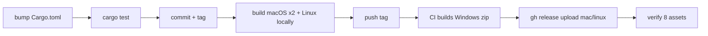

# Release agent-hooks

Split build: macOS + Linux are built **locally** (`dist/` is gitignored);
**Windows is built by CI** (`.github/workflows/release.yml` runs on tag push
and publishes `agent-hooks-x86_64-pc-windows-msvc.zip`). Tag format: `v*`.



## 0. Preflight

```bash
git status --porcelain            # MUST be clean; stash or commit first
git branch --show-current         # MUST be main
grep '^version' Cargo.toml        # current version, e.g. 0.5.6
```

Pick the next version (semver): patch = fix, minor = feature, major =
breaking. New version below is `X.Y.Z`.

One-time toolchain setup (skip if present):

```bash
rustup target add aarch64-apple-darwin x86_64-apple-darwin x86_64-unknown-linux-gnu
cargo install cargo-zigbuild     # Linux cross-link via zig (glibc, no docker)
```

### Harness verification check

Ask the user: *"Have any supported harnesses shipped new versions since the
last release, or were new harnesses added? Were they verified live, and
against which version?"* For each:

- Offer to run the `verify-harness` skill for it first.
- Verified live: set `verified_against` in its `adapter.json` to that version
  (clear `unverified` if it was set).
- Not verified: leave it as is and mention it in the release notes.

Then `scripts/gen-adapter-table.py` and include the README change in the
release commit. Do not invent versions; only record what the user confirms.

## 1. Bump + commit

Single source of truth: root `Cargo.toml` `[workspace.package] version`
(all crates inherit via `version.workspace = true`).

```bash
# edit Cargo.toml: version = "X.Y.Z"
cargo check --workspace --locked  # refreshes Cargo.lock, catches breakage
cargo test --workspace            # MUST pass before tagging
git add Cargo.toml Cargo.lock README.md crates/agent-hooks-adapters/builtin
git commit -m "release: agent-hooks X.Y.Z"
```

## 2. Build all three local targets

Native macOS builds plus zigbuild cross-compile for Linux (output matches
the published ABI: `ELF x86-64, dynamically linked, interpreter
/lib64/ld-linux-x86-64.so` — verify with `file`):

```bash
rm -rf dist && mkdir -p dist
cargo build --release --locked -p agent-hooks-cli --target aarch64-apple-darwin
cargo build --release --locked -p agent-hooks-cli --target x86_64-apple-darwin
cargo zigbuild --release --locked -p agent-hooks-cli --target x86_64-unknown-linux-gnu
file target/x86_64-unknown-linux-gnu/release/agent-hooks  # expect ELF 64-bit LSB, x86-64
```

If `cargo zigbuild` fails, `zig` is missing: `brew install zig`, then
`cargo install cargo-zigbuild --force`.

## 3. Package + smoke test

Layout per target (mirrors the install docs): a stage dir
`agent-hooks-<target>/` containing `agent-hooks` + `README.md`, tarred with
a sibling `.sha256`:

```bash
BIN=agent-hooks
for T in aarch64-apple-darwin x86_64-apple-darwin x86_64-unknown-linux-gnu; do
  STAGE="dist/$BIN-$T"
  mkdir -p "$STAGE"
  cp "target/$T/release/$BIN" "$STAGE/"
  cp README.md "$STAGE/"
  tar -czf "dist/$BIN-$T.tar.gz" -C dist "$BIN-$T"
  (cd dist && shasum -a 256 "$BIN-$T.tar.gz" > "$BIN-$T.tar.gz.sha256")
done
ls dist/*.tar.gz dist/*.sha256
```

Smoke test every binary before tagging (linux binary can't exec on macOS —
check the ELF header via `file` instead, done in §2):

```bash
./dist/agent-hooks-aarch64-apple-darwin/agent-hooks --version  # expect X.Y.Z
arch -x86_64 ./dist/agent-hooks-x86_64-apple-darwin/agent-hooks --version || \
  file target/x86_64-apple-darwin/release/agent-hooks
```

Rosetta (`arch -x86_64`) is needed for the Intel binary on Apple Silicon;
if Rosetta is absent the `file` fallback (Mach-O 64-bit x86_64) suffices.

## 4. Tag, push, let CI build Windows

```bash
git tag vX.Y.Z
git push origin main vX.Y.Z
gh run watch   # windows-2022 job: builds + publishes the -pc-windows-msvc.zip
```

Tag push is the CI trigger (`on.push.tags: v*`). Do NOT build Windows
locally — there is no local Windows step by design.

## 5. Upload macOS/Linux assets + verify

Once CI's `publish` job has created the release, attach the six local files
(three tarballs + three checksums). If CI hasn't created it yet,
`gh release create` first — `action-gh-release` appends to an existing
release either way:

```bash
gh release view vX.Y.Z >/dev/null 2>&1 || gh release create vX.Y.Z --generate-notes
gh release upload vX.Y.Z dist/*.tar.gz dist/*.tar.gz.sha256
gh release view vX.Y.Z --json assets --jq '.assets[].name'
```

Expected: 8 assets —

```text
agent-hooks-aarch64-apple-darwin.tar.gz(.sha256)
agent-hooks-x86_64-apple-darwin.tar.gz(.sha256)
agent-hooks-x86_64-unknown-linux-gnu.tar.gz(.sha256)
agent-hooks-x86_64-pc-windows-msvc.zip(.sha256)
```

If a filename is wrong or an asset missing, the README install table (§
"Install the binary") breaks — fix the name, re-upload with
`gh release upload --clobber`.

## 6. Done

`dist/` stays local (gitignored) — nothing to commit after tagging. Leave
the tree clean: `git status --porcelain` empty apart from nothing.
